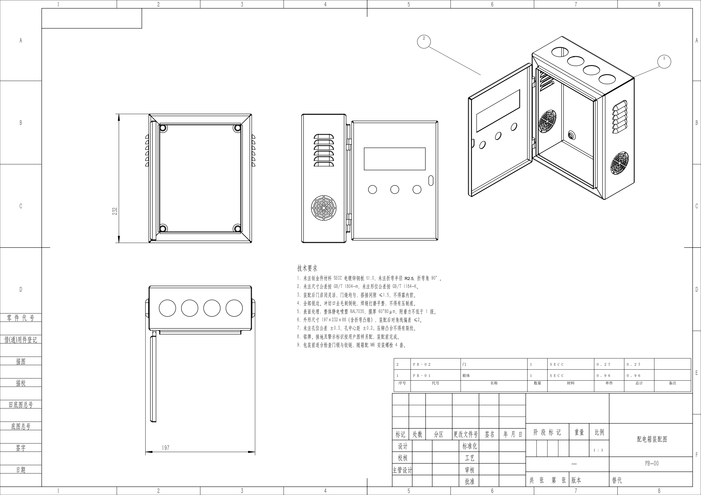
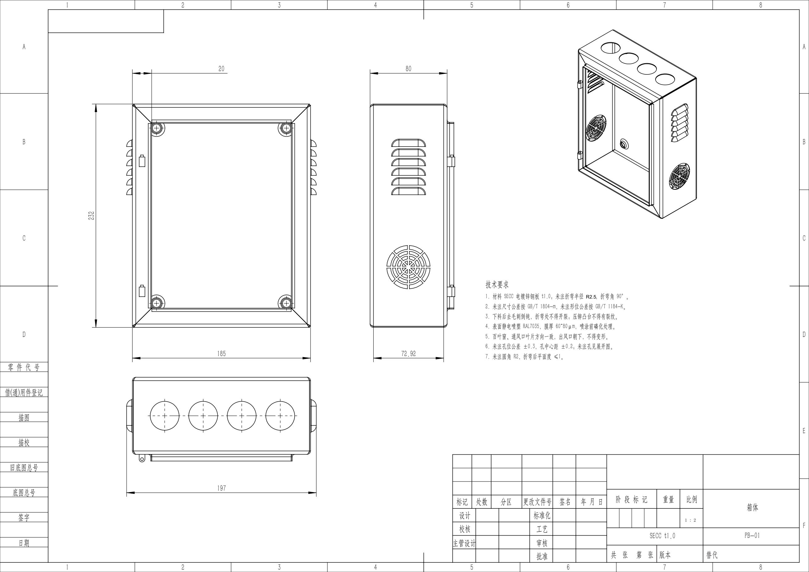
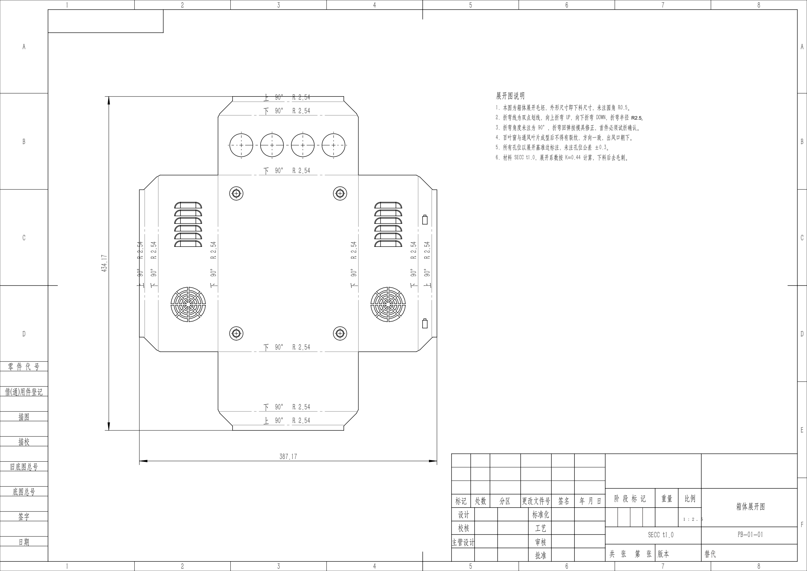
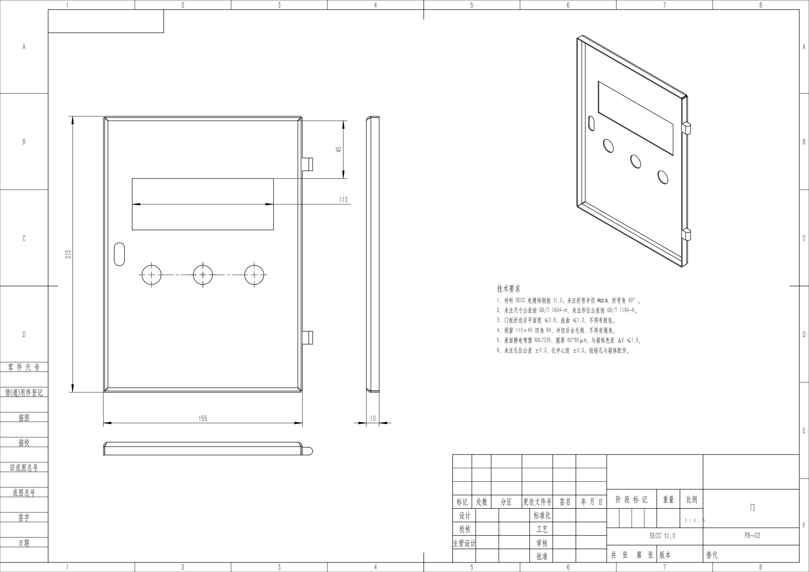
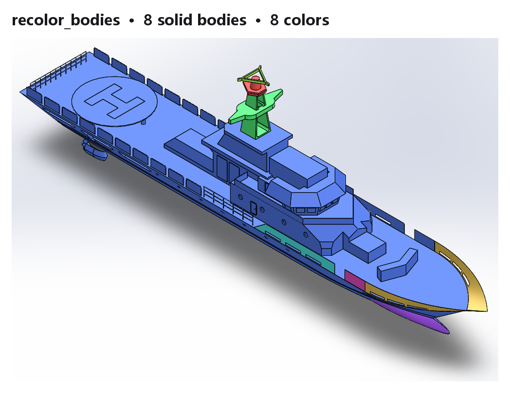

# Solidworks_AssetMate_MechDog

    

**一个会出图、也能证明这张图不能交的 SolidWorks MCP 服务。**

别的工具告诉你「生成了几张图」，它告诉你「台账 37 个尺寸里图上只找到 32 个、8 个尺寸挂不到几何上、0 个带公差，所以这张图只能算参考稿」。

**能做的不只是尺寸**：孔标注、形位公差、表面粗糙度、标题栏、**原生 BOM 明细栏**、技术要求注记，都是走 SolidWorks 原生对象——明细栏会随装配更新，件号与行号对应。

Windows + SolidWorks 2020+，纯 Python + COM，不需要编译 C# 插件。MCP 注册名：`Solidworks_AssetMate_MechDog`。

- **适合**：批量零件出图、已有图纸的尺寸/标注补齐与自检、装配 BOM 与上色、把「这张图能不能交」变成可复核的回执。
- **不适合**：自由曲面造型、仿真（静力学/模态）、CAM 刀路、没有真实 SolidWorks 与许可的「云端出图」。

| 我想… | 看这里 |
|---|---|
| 装好并接进 MCP 客户端 | [环境要求](#环境要求) · [安装](#安装) |
| 直接出一张图并看到预期回执 | [快速开始](#快速开始) |
| 查某个工具的参数 | [功能一览](#功能一览) · [三个能力域](#三个能力域) |
| 判断这张图能不能交 | [工程图闭环](#工程图闭环从台账到交付判定) |
| 看真实图纸的统计基线 | [真实图纸基线](#真实图纸基线) |
| 知道哪些做不到、为什么 | [能力边界（诚实披露）](#能力边界诚实披露) |
| 改代码 / 发版 / 跑真机 | [开发与自检](#开发与自检) · [真机回归](#真机回归) |
| 查历史踩坑与 COM 口径 | [docs/com-quirks.md](docs/com-quirks.md) |

---

## 特性

- **原生参数化**：尺寸、孔标注、形位公差、粗糙度、BOM 明细栏、标题栏全部是 SolidWorks 原生对象，改模型会跟着变；不是画线拼的图元。
- **能证明「不能交」**：`delivery_check` 给三档结论（可制造 / 待设计审核 / 仅供参考），`call_status` 区分「不完整」与「失败」——两者都不靠「生成成功」交差。
- **台账驱动**：`build_feature_ledger` 先数清模型有哪些特征/驱动尺寸/孔，`plan_drawing` 决定只标哪 11 个（真实图纸尺寸中位数），一条命令走完。
- **每一步回读**：孔径、公差类型、剖切实际位置、粗糙度像素 diff、标注挂没挂到几何——`ok:true` 不等于图上是对的。
- **失败可解释**：COM 不可用、模板不套框、角度落在平行边上，都返回结构化错误码 + `docs/com-quirks.md` 的对应章节，不假装成功。
- **统一会话层**：所有工具共用 `sw_session`，慢调用只取一次；`ping` 约 18 ms，忙时退避重试、断线自动重连。
- **依赖可复现**：仓库自带 `.venv` 安装步骤并锁定 `mcp>=1.2,<2`，避开 `mcp` 2.x 移除 `mcp.server.fastmcp` 的坑。

---

## 实际产出

一套配电箱（钣金 t1.0）的完整生产图纸，全部由本工具生成：

| 图纸 | 内容 |
|---|---|
| 装配图 | 3 视图 + **原生 BOM 明细栏**（门/箱体）+ 件号气泡（**界面手插**，见下）+ 9 条技术要求 |
| 箱体零件图 | 4 视图 + 尺寸链 + 7 条技术要求（材料/折弯半径/喷塑） |
| 箱体展开图 | 展平 + 下料尺寸 + 折弯线 |
| 门零件图 / 展开图 | 同上 |

### 装配图（含 BOM 明细栏与件号）



> 右下角明细栏是**原生 BOM**（`BomFeature` 可取，会随装配更新），不是画线拼的表格。
> 件号 ① ② 与明细栏行号对应。
>
> **注意**：这两个气泡是**界面手工添加**的——`InsertBOMBalloon2` 需要 9 个必填参数、`InsertBalloon` 在 SW2024/SW2026 下都是 `DISP_E_UNKNOWNNAME`，所以没有对应的 MCP 工具，`check_capabilities` 里 `balloon` 标的是 `unsupported`。明细栏行号本身是正确的，手插时照抄即可。

### 箱体零件图



### 箱体展开图



### 门零件图



---

## 环境要求

| 项目 | 要求 |
|---|---|
| 系统 | Windows x64 |
| Python | 3.10+ x64，**与 SolidWorks 位数一致** |
| CAD | SolidWorks 2020 或更新（开发验证 2024 SP4；用户实测 2026 SP0 可用） |
| 渲染依赖 | Pillow、pypdfium2（0.8.23 起为硬依赖：`render_drawing` 与像素自检要用） |
| 接口 | MCP stdio（`mcp>=1.2,<2`，FastMCP） |
| 许可 | 你自己的 SolidWorks 许可；MIT 只覆盖本项目代码与文档 |

SolidWorks 安装、模板与许可需自行准备；`测试用例/` 因体积与版权不入库，真机回归要自备模型。

## 安装

**先建项目自己的 venv，不要装进系统 Python。** 不是洁癖：`mcp` 2.x 删掉了
`mcp.server.fastmcp`，装进系统解释器后 `server.py` 直接 `ImportError`；而 pywin32 又必须与
SolidWorks 的位数一致。两者分开最省事。

1. 取源码（`git clone` 或 release tarball），进入仓库根目录。

2. 建 venv 并安装：

   ```bat
   py -3.11 -m venv .venv
   .\.venv\Scripts\python.exe -m pip install -U pip setuptools wheel
   .\.venv\Scripts\python.exe -m pip install -e .
   ```

   `--no-build-isolation` 时 venv 里必须有 `wheel`，否则报 `invalid command 'bdist_wheel'`
   （2026-11-15 本机实测）。Pillow 与 pypdfium2 已随包安装；旧命令 `pip install ".[png]"` 仍可用作兼容别名。

3. 装完自检（都不需要 SolidWorks，但都在同一个 venv 里跑）：

   ```bat
   REM 4 套件：语法 + 结构 + 334 条回归 + 真实 stdio MCP 契约，约 3 分钟
   .\.venv\Scripts\python.exe tests\check_all.py
   ```

   `stdio_contract.py` 已在 `check_all` 的第 4 步里跑，**不必再单独执行**（0.8.347 起；
   单跑只在想只看契约输出时有用）。

4. 接进 MCP 客户端（指向 venv，不依赖 PATH）：

   ```json
   {
     "mcpServers": {
       "Solidworks_AssetMate_MechDog": {
         "command": "<仓库路径>\\.venv\\Scripts\\python.exe",
         "args": ["-m", "solidworks_assetmate_mechdog.server"]
       }
     }
   }
   ```

5. 重启客户端后调用 `ping`（应给出版本与往返延迟），再 `check_capabilities` 确认这台机器上哪些能力可用。

| 现象 | 处理 |
|---|---|
| `invalid command 'bdist_wheel'` | venv 里缺 `wheel`：`pip install setuptools wheel` 后再装 |
| `No module named 'mcp.server.fastmcp'` | 装到了 mcp 2.x 的环境；本项目要求 `mcp>=1.2,<2`，用仓库 `.venv` |
| `No module named 'pythoncom'` | 解释器位数与 SolidWorks 不一致，或没装 pywin32 |
| 隔离构建下载 `setuptools` 失败 | 先 `pip install setuptools wheel`，再加 `--no-build-isolation` |
| 镜像报 `from versions: none`（实为 403） | 换源 `-i https://mirrors.aliyun.com/pypi/simple/` |
| 找不到 `solidworks-assetmate-mechdog` 命令 | 入口在 `.venv\Scripts`，或改用 `-m` |
| 工程图视图创建返回空 | 0.3.0 已处理（中文版视图名 `*前视`） |
| 所有工具报 `int() argument must be ... VARIANT` | 0.1.5 已修复（强制晚绑定） |

---

## 快速开始

一条命令出一张图，然后看回执判断能不能交：

```jsonc
// produce_drawing：台账 → 规划 → 建图 → 标注 → 自检 → 判定
{ "model_path": "D:/parts/接槽.SLDPRT",
  "output_path": "D:/out/接槽.SLDDRW",
  "paper": "A3" }
```

跑完应看到（A3、单零件、默认参数，本机实测）：

```json
{ "ok": false, "call_status": "incomplete", "execution_ok": true,
  "error": "delivery_incomplete", "completeness": "incomplete",
  "verdict": "待设计审核",
  "partial_steps": ["hole_callouts"], "failed_steps": [], "blockers": [] }
```

**`ok:false` 不等于调用失败。** 图纸已经生成，只是孔标注那一步没做完。判据只看 `call_status`：
`incomplete` = 打开图纸检查，**不要重试、不要回滚**；`failed` 才是失败。详见
[工程图闭环](#工程图闭环从台账到交付判定)。

两个约定：

- **先问再画**：`check_capabilities` 声明这台机器哪些能力不可用，`plan_drawing` 给出该标哪几个尺寸——真实图纸尺寸中位数 11 个，全量导入会把 70 个驱动尺寸全倒上去。
- **写操作默认 dry-run**：`apply:false` 返回修改前的值，确认后再 `apply:true`。

### 常见调用

**出一张图并自检**

```jsonc
// 1. 建图
{ "model_path": "D:/parts/P05.SLDPRT", "output_path": "D:/out/P05.SLDDRW",
  "views": ["front", "right"], "paper": "A3", "view_scales": { "right": 0.2 } }

// 2. 标注（导入 + 中心标记 + 标题栏）
{ "drawing_path": "D:/out/P05.SLDDRW", "all_views": true, "include_unmarked": false }
{ "drawing_path": "D:/out/P05.SLDDRW", "name": "履带轮", "code": "P05", "apply": true }

// 3. 判定能不能交
{ "model_path": "D:/parts/P05.SLDPRT", "drawing_path": "D:/out/P05.SLDDRW" }
```

**查缺哪些尺寸**

```json
{ "model_path": "D:/parts/P05.SLDPRT", "drawing_path": "D:/out/P05.SLDDRW" }
→ coverage 0.879, unmatched_by_feature: { "Cut-Extrude1": [1.0, 30.0], "Vent1": [1.0] }
```

**装配上色**

```json
{ "assembly_path": "D:/models/beast.SLDASM",
  "palette": { "Crank": [0.88, 0.20, 0.18], "Frame": [0.36, 0.40, 0.45] },
  "apply": false }
```

dry-run 确认零件与匹配数无误后，再 `apply=true`。



---

## 功能一览

| 类别 | 代表工具 |
|---|---|
| 一条命令出图 | `produce_drawing`（台账 → 规划 → 建图 → 标注 → 自检 → 判定） |
| 建模视图与版面 | `create_drawing`、`add_section_view`、`add_detail_view`、`add_flat_pattern_view`、`place_views` |
| 尺寸与公差 | `auto_dimension`、`add_distance_dimension`、`add_angular_dimension`、`add_dimension_tolerance` |
| 制造标注 | `add_hole_callouts`、`add_geometric_tolerance`、`add_surface_finish`、`add_datum_feature`、`add_weld_symbol` |
| 图纸对象 | `add_bom_table`、`set_title_block`、`add_technical_requirements`、`add_sheet` |
| 自检与判定 | `drawing_audit`、`reconcile_ledger`、`verify_dimension_attachments`、`delivery_check` |
| 装配与零件 | `get_assembly_tree`、`export_bom`、`recolor_assembly`、`build_feature_ledger` |
| 导出 | `export_drawing`（PDF/DWG/DXF）、`render_drawing`（PNG 目视）、`batch_export`（STEP） |

全部 84 个工具按能力域展开见下；运行时以 `list_tool_profiles` 与 `check_capabilities` 为准。

## 三个能力域

### 一、装配与零件（14）

| 工具 | 作用 |
|---|---|
| `get_assembly_tree` | 组件树：零件名、路径、颜色、子装配递归 |
| `export_bom` | BOM：按零件聚合，数量/材料/单重/总重，可写 CSV |
| `get_mass_properties` | 整机质量/体积/表面积/质心 |
| `recolor_assembly` | 按零件类型批量上色（黄金比例配色，同零件同色） |
| `recolor_bodies` | 多实体零件逐实体分色 |
| `list_bodies` | 零件实体清单（面/边/顶点数） |
| `rename_components` | 重命名零件文件，可选重定向装配引用 |
| `export_preview` | 视图导出 BMP/PNG |
| `batch_export` | 批量 STEP（默认 dry-run，不覆盖） |
| `set_part_material` | 指定材质，回读材质与质量变化 |
| `assign_materials` | 按名称关键词智能分配（标准件→碳钢，结构件→铝） |
| `material_library` | 列本地材质库名称（解析受限，见边界） |
| `build_feature_ledger` | **特征台账**：特征/驱动尺寸/孔候选/模型疑点/零件类别 |
| `export_sketch_geometry` | **草图逐点几何**（0.8.309 新增）：每段线/弧的长度、直线端点由 `LineParams`+`GetLength` 精确算出、圆弧给圆心/轴/半径/包角并从点集反解端点；`plane_frame` 恒 null（本 binding 读不到基准面），坐标是**草图局部坐标** |

### 二、工程图（54）

| 工具 | 作用 |
|---|---|
| `produce_drawing` | **一条命令出图**：台账→规划→建图→标注→自检→判定，按类别套默认值 |
| `create_drawing` | 建图：A0–A4、多视图、逐视图比例、`view_positions` 显式摆位、模板安全区实测 |
| `set_view` | 移动/缩放单个视图（`DISPATCH_PROPERTYPUT` + VARIANT，直接赋值会静默写错） |
| `place_views` | 批量摆视图：`[{view, x, y, scale}]` |
| `add_section_view` | 剖视图（自动画剖切线）；支持**模型坐标剖切面** `cut_plane_normal`/`cut_plane_origin`；`cut_line_ratio`（默认 0.55）按**短边**钳制剖切线长度。错误码：`section_empty` / `section_suspicious` / **`hatch_missing`（剖切面无剖面线，0.8.56 起不再 ok:true）** |
| `add_detail_view` | 局部放大（圆圈边界 + 独立比例）；请求比例不再被父视图覆盖，创建后数可见边，空视图返回 `detail_empty`、比例被锁返回 `detail_scale_locked` |
| `add_flat_pattern_view` | 钣金展开（下料尺寸 + 折弯线） |
| `survey_dimensions_by_view` | **只读诊断**：每个视图的尺寸数、最密的视图、空视图；用于判断「右视图为什么是空的」。**不能改派**——尺寸属于所在视图 |
| `auto_dimension` | 导入模型驱动尺寸，超 30 个会提示冗余；**按模型 full name 自动删除重复副本** |
| `delete_dimensions` | **按值保留/删除尺寸**，消费 `plan_drawing` 的短名单（实测 14 条一次调用 < 5 s） |
| `set_view_scale` | 改单个视图的比例（不必重建整张图） |
| `move_view` | 把单个视图移到图纸指定点（米） |
| `close_document` | 关闭 SolidWorks 仍占用的文档（释放文件，可删除/替换） |
| `add_center_marks` | 孔/槽中心标记与中心线（`view_name` 可限定视图） |
| `list_circular_edges` | 列视图内圆边（图纸坐标 + 直径），孔标注的前置工具 |
| `add_hole_callout` | 原生孔标注（带回读 + 模型孔径比对） |
| `add_hole_callouts` | **批量孔标注**：单视图可见边 → `AddHoleCallout2`，`IsHoleCallout` 判定（pilot），可指定引线落点 |
| `add_distance_dimension` | **两条边之间的距离**——总长这类「多段相加」的尺寸只能这样标；实测旋转轴 edge3–edge6 = 60.0 mm |
| `add_angular_dimension` | **原生关联角度尺寸**（0.8.308 新增）。两条边夹角一次生成，回执给 `value_deg` 且 `value_mm` 恒为 null；两边平行时返回 `not_angular` 并撤销。45° 不再只能删标注改文字 |
| `add_drawing_dimension` | 按边索引/坐标补标单个尺寸（失败返回最近边模型/图纸坐标 + 距离） |
| `add_dimension_tolerance` | 原生尺寸公差（双边/对称/极限/配合） |
| `add_datum_feature` | **基准要素符号**（三角形+字母），形位公差的基准真正指向它；`InsertDatumTag2` 挂在选中边上，用 `view_name`+`edge_index` 定位 |
| `add_geometric_tolerance` | **原生形位公差**（公差值 + 多基准 + 引线）；符号格写中文文字并回读校验，写不进就删框返回 `gtol_symbol_not_applied` |
| `add_surface_finish` | **原生表面粗糙度**（Ra 值，14 参数）；`InsertSurfaceFinishSymbol3` 会忽略 x/y，用 `SetPosition` 修正后回读，可选 PDF 像素 diff 自检 |
| `add_weld_symbol` | **角焊缝符号**（参考线 + 三角 + 焊脚尺寸 + 引线）；**`representation="sketch_block"`——草图线绘制，不是原生 IWeldSymbol**（该 API 在本环境不实例化几何） |
| `add_technical_requirements` | **技术要求整块写入**（一个 note 多行，不是 N 次 `add_note`）；自动编号 + 自动找空位（避开视图真实轮廓） |
| `add_note` | 技术要求注记（sheet 空间坐标，米） |
| `layout_dimensions` | **拆开叠在一起的尺寸**（按 x 聚类后沿 y 推开） |
| `delete_view` | **删除视图**（错切的剖视 / 空白局部放大） |
| `delete_annotation` | **删除标注**（按 name，回读计数确认） |
| `move_annotation` | **移动标注**到图纸坐标（米） |
| `set_dimension_position` | **移动单个尺寸**到图纸坐标（米），校验目标是尺寸并回读数值与位置 |
| `add_hole_table` | **原生孔表**（0.8.354 新增）：以视图顶点为基准插入 `.sldholtbt` 表；`holes_listed` = 行数−1，只列**孔向导/孔系列**孔，普通拉伸切除的孔不进表 → 那时返回 `ok:false` + `hole_table_empty`，不留空表当成功 |
| `add_native_weld_symbol` | **原生焊接符号**（0.8.365 新增）：`InsertWeldSymbol3()` 在选中边后创建注解类型 8 的真符号（此前 `list_drawing_annotations` 把类型 8 标成 `datum_tag`，所以没人发现它可用）；符号种类/尺寸/尾部文字暂未开放 |
| `add_model_dimensions` | **模型尺寸带入所有视图**（0.8.366 新增）：`InsertModelAnnotations4` 在 `IDrawingDoc` 上；`types` 必须是 **65535**（0 或窄掩码会一条都不插，看起来像「第二视图插不进去」）|\n| `create_orthographic_views` | **原生对齐正投影**（ZJZL 批 3）：`CreateUnfoldedViewAt3` 建原生子视图，按图页第一/三角法摆位；校验父视图/模型/配置/法向/比例/位置，失败整批撤回 |
| `create_custom_view` | **任意方向视图**（ZJZL 批 3）：临时改模型视口 → `NameView` → 建视图 → 恢复视口并删临时名；回读旋转矩阵与位置，源模型不保存 |
| `probe_geometry` | **可见几何 + 持久引用**（ZJZL 批 2）：每条边/顶点带 `GetPersistReference3` 引用，保存重开仍可解析；坐标分三套（`endpoints_local_m` 视图局部 / `point_model_m` 模型 / `point_sheet_m` 纸面）|
| `add_reference_dimension` | **括号从动参考尺寸**（ZJZL 批 2）：按类型走 `Add*Dimension2`，`ShowParenthesis` + `DrivenState==1` + `GetAttachedEntities3` 逐项校验，失败自动删掉 |
| `add_balloon` | **原生件号圆圈**（0.8.364 新增）：`InsertBOMBalloon2` 在 `IModelDoc` 上，需先选中一条**边**；无 BOM 表时文字读 `?`，传 `item` 写入自己的件号 |
| `add_bom_table` | **原生 BOM 明细栏**（Indented→TopLevelOnly 两步，10 行 4 列含数量） |
| `add_sheet` | ✅ **可用**（0.8.196）：一个 `.SLDDRW` 内建多页。从 0.8.180 到 0.8.195 我一直写「`NewSheet4` 调不通」——**是我猜错了参数顺序**，`TemplateIn` 是第三个且必须是 int。实测 `('图纸1',)` → `['图纸1','图纸2']`。 |
| `list_sheets` | ✅ 列出每一页：名称、尺寸、视图、哪个是活动页。只有活动页会被其它工具修改。 |
| `activate_sheet` | ✅ 切页（按 `name` 或 `index`）。`add_sheet` 之后新页是活动的且**没有视图**，标注前先切回有视图的那一页。 |
| `add_view_to_sheet` | ✅ 在**指定页**建模型视图（先切页再 `CreateDrawViewFromModelView3`）。这是多页出图的另一半：`add_sheet` 建页，它往页上放东西。 |
| `measure_layout` | 量**现有**图纸：每个视图的包围盒、视图组占位、`views_fill_ratio`（远低于 1 说明视图散在包围盒里）、四周余量与 `min_margin_m`（还没被占用的版面预算）。只读，全部用 `precise_outline`。 |
| `list_sheet_sketch` | **读图纸草图段**（0.8.355 新增）：sheet 或某个视图的草图里有哪些线段、长度、起点/方向；给出 `delete_sheet_sketch` 用的索引 |
| `delete_sheet_sketch` | **删图纸草图段**（0.8.355 新增）：按索引删（`dry_run` 默认 true）。关键是**先进草图编辑态**再删 —— 只选中段调 `EditDelete` 什么都删不掉 |
| `add_sheet_line` | ✅ **能渲染，前提是 `AddToDB=True`**（2026-11-06 实测 572 像素；之前 0 像素是因为缺这个开关）。默认 `verify_render=True`，看 `visibility`：`changed_pixels>0` 画上了，`0` 返回 `line_not_rendered`，`checked:false` 表示渲染器不可用（**不等于没画**）。实测范围仅 SW2024 SP4 + 飞达动力轴 A3。 |
| `set_title_block` | 标题栏：文字匹配 + 位置兜底两级策略 |
| `list_drawing_edges` | 视图可见边（索引 + 模型坐标 + **图纸坐标** `sheet_start/end`；失败时 `sheet_projected:false` 带原因） |
| `export_drawing` | PDF / DWG / DXF |
| `render_drawing` | PDF → PNG，供目视检查 |

### 三、规划与自检（16）

| 工具 | 回答什么问题 |
|---|---|
| `drawing_audit` | 有没有空视图、越界、互相重叠 |
| `list_drawing_annotations` | 图上到底有多少尺寸/公差/形位公差/粗糙度（模板文字单列） |
| `verify_dimension_attachments` | 每个尺寸挂在边/面/草图段，还是根本没挂 |
| `prune_orphan_dimensions` | **清掉挂不到实体的尺寸**：按 name+position 删，`delete_dimensions` 按值做不到（三个 23 mm 无法区分）；dry-run 默认，删后重跑校验 |
| `reconcile_ledger` | **台账对账**：模型的 58 个尺寸，图纸上缺哪 7 个 |
| `plan_dimension_gaps` | **缺口补偿规划**：把真缺的尺寸配成边对，唯一匹配才补 |
| `delivery_check` | **这张图能不能交** |
| `export_delivery_report` | **交付清单**：把 `delivery_check` 的结论落成一页 Markdown（阻断项/待确认/检查项/实测数据/**计划级尺寸覆盖**/逐页/可选钣金），末尾附原始 JSON 回执；**不新增判断**，只复述。`dimension_coverage` 传 `auto_dimension` 的那个对象就会有数字（0.8.346） |
| `sheet_metal_qc` | 板厚/弯折数/止裂槽；做不到的检查标 `not_checked`，不给假通过 |
| `flat_pattern_report` | 展开尺寸**谁算的**、工具没做什么、图上该写什么措辞 |
| `survey_drawings` | 抽样真实图纸出统计基线 + HTML 画像报告 |
| `plan_drawing` | 出图前规划：保留哪些尺寸、几张图、怎么拆（不建图） |
| `check_capabilities` | 动手前声明：哪些做不了、证据、替代方案；回显**运行中的版本 + 源码路径 + 解释器** |
| `ping` | **最轻的存活探针**（约 18 ms，不碰 ActiveDoc）：SW 版本、往返延迟、上一个工具、自愈计数 |
| `list_tool_profiles` | 84 个工具的**建议分组**（standard / drawing / expert / full）。**只是清单，不过滤任何工具**；`ungrouped` 非空说明有工具忘了归类 |
| `health_check` | **桥接与 SolidWorks 是否都活着**（可分辨"桥死了"与"SW 不响应"） |
| `recent_failures` | **读回当日失败日志**（工具名/参数/错误/SW 版本/健康快照） |

---

## 工程图闭环：从台账到交付判定

```
特征台账 ──→ 出图 ──→ 标注 ──→ 自检 ──→ 交付判定
   │                             │           │
   │  有哪些特征/尺寸/孔          │  有没有  │  可制造
   └─────────────────────────────┴──────────→ 待设计审核
                                              仅供参考/未完成
```

`delivery_check` 的三种结论：

| 结论 | 触发条件 |
|---|---|
| **可制造** | 关键尺寸/孔/公差齐全，双重自检通过 |
| **待设计审核** | 图纸对象正确，但含调用方声明为「AI 拟定」的关键值 |
| **仅供参考/未完成** | 有越界/重叠/空视图、无尺寸、模型疑点、缺孔标注、尺寸无关联 |

实测配电箱箱体：

```
verdict: 仅供参考/未完成
blockers:  模型 Flat-Pattern1 被抑制
           图纸 0 处孔标注 / 模型 80 个圆柱面
pending:   27/53 尺寸读不到关联
           台账覆盖率 0.879（51/58，缺 7 个）
```

**这就是核心价值**：不是"生成成功"，而是"缺什么、能不能交"。

> 上面这条记录来自 v0.4 那次实测。现在孔标注已经能做（`add_hole_callouts`），
> 如果重跑，那行 blocker 会消失——但**工具依然会如实报出当时真实存在的缺陷**，
> 而不是因为"新版本支持了"就把历史问题抹掉。

### `produce_drawing`：不完整 ≠ 失败

`ok` 只回答一个问题：**是不是全做完了**。所以「图纸已生成、某个非关键步骤没做完」会返回
`ok: false` + `error: "delivery_incomplete"` —— 这是有意的（放宽 `ok` 会让
`ok:true` + `completeness:"incomplete"` 那个 P0 复活）。但 `ok:false` + 非空 `error`
恰好也是「调用失败」的标准形状，外部客户端很容易误判。

判据只看一个字段 **`call_status`**：

| 值 | 含义 | 该做什么 |
|---|---|---|
| `"ok"` | 全部完成 | 直接用 |
| `"incomplete"` | **图纸已经生成**，有步骤没做完或需人工确认（`partial_steps` / `blockers`） | 打开图纸检查，**不要重试、不要回滚** |
| `"failed"` | `execution_ok:false` 或 `failed_steps` 非空 | 这才是失败，重试或报错 |

```python
got = json.loads(produce_drawing(...))
if got["call_status"] == "incomplete":
    print(got["verdict"], got["partial_steps"], got["blockers"])
elif got["call_status"] == "failed":
    raise RuntimeError(got["message"])
```

`error: "delivery_incomplete"` 属于 `incomplete` 这一类，不是失败。

**`ok` 与 `effective` 是两件事（0.8.352 起）**：`ok` 只回答「调用有没有失败」，`effective` 回答
「图面有没有真的发生变化」——

| 字段 | `true` | `false` | `null` |
|---|---|---|---|
| `ok` | 调用成功且无已知缺陷 | 有缺陷或**什么都没做成** | 不存在 |
| `effective` | 有可验证的变化（新建了标注、写入了字段） | 证明了没有变化（0 条创建 / 8 条被拒） | **无法证明**：该 binding 读不到结果（如 `GetCenterMarkCount` 恒 0） |

`effective:false` 时 `ok` 也是 `false`，`call_status:"failed"`，回执带 `error` 说明原因；
`effective:null` 时 `ok:false` 但 `call_status:"incomplete"` —— 「无法证明」不等于「失败」，
`produce_drawing` 会把它记成 `warning` 步骤，而不是失败步骤。

**`call_status` 的适用范围（0.8.346 明确）**：它是**所有工具**的通用字段，语义固定为「这次调用该怎么处理」——
`ok` 可直接用、`incomplete` 有产物但没做完、`failed` 什么都没得到。目前只有 `produce_drawing` 会产出
`incomplete`；其余工具要么 `ok`，要么 `failed`（任何 `error` 回执都在 `sw_session.error()` 里统一带上
`execution_ok:false` + `call_status:"failed"`）。客户端按三值分支即可，不需要区分是哪个工具。

### 部分结果不等于成功

`ok()` 用 `setdefault`，调用方可以传 `ok=False`；`add_hole_callouts` 在跳过倒角歧义直径时
就传 `ok=False, verdict="partial"`，并写 `partial_reason` 与 `excluded_diameters_mm`。
`produce_drawing` 会把它抬到顶层（`ok:false` + `partial_steps`）、写进 `pending`，
并由 `_callout_warning()` 说明缺哪几个直径。

单孔 `add_hole_callout` 另给 `text_flags`：读不到图面文字时报 `text_unreadable`，
带深度符号时报 `depth_on_a_through_bore_suspect` —— **`ok:true` 不等于文字是对的**。

---

## 真实图纸基线

判定标准不是凭感觉定的。用 142 套 SolidWorks 工程图模板里 **6346 张真实 SLDDRW** 抽样 100 张实测：

| 指标 | 平均 | 中位 | 范围 |
|---|---|---|---|
| 视图 | 3.1 | 3 | 1–9 |
| **尺寸** | **14.2** | **11** | 0–58 |
| 注释 | 46.5 | 36 | 0–160 |
| 中心标记 | 4.9 | 3 | 0–59 |

**制造类标注的出现率**

| 标注 | 占比 |
|---|---|
| 表面粗糙度 | **60%** |
| 形位公差 | **7%** |
| 零件序号 | 3% |

据此改掉三条拍脑袋的标准：

| 原来 | 改后 | 依据 |
|---|---|---|
| 全量导入 44 个尺寸 | 提示冗余 | 真实 14 个，制图是筛选不是搬运 |
| 要求形位公差 | 降为可选、粗糙度升为常规 | 7% vs 60% |
| 视图无尺寸即报警 | 只在整张图无尺寸时报警 | 原判定 79/100 误报，改后 6 |

复跑基线（换新图纸后应重做）：

```json
{ "folder": "D:/142套solidworks工程图图纸模板",
  "sample_size": 100, "seed": 28,
  "html_path": "D:/out/survey_report.html" }
```

固定 `seed` 保证样本可复现，改阈值前后能直接对比。

---

## 视图数量与拆图策略

A3 / 1:2、带标注的情况下实测：

| 图幅 | 视图数 | 结果 |
|---|---|---|
| A3 | 2–3 | `drawing_audit` 零警告 |
| A3 | 4 | 互挤，常压到左侧明细栏 |
| A3 | 5 | 越界 + 重叠，不可用 |

**剖视图位置半锁**：与父视图 x 对齐（`Position` 只有 y 生效），只能放在源视图正上/正下方。

**拆图建议**（钣金件必用）：

1. **结构图**：主视 + 侧视 + 剖视（≤3 视图）
2. **展开图**：钣金展开 + 成型对照视图

实测配电箱：5 视图一张 = 4 处越界 + 1 重叠；拆成两张 = 两张都零警告。

---

## auto_fit 实测

自动比例在三个数量级的真实装配上验证过（原路径建图，图纸输出到临时目录）：

| 装配 | 包围盒 | 自动比例 | 结果 |
|---|---|---|---|
| LX-12 输送 | 108 × 42 × 42 mm | 1:1 | 双视图并排，无越界 |
| 焊接夹具 3C01400300A0 | 687 × 86 × 182 mm | 1:5 | 含 Ø8.5 标注，无越界 |
| 条码设备 SAB1_0000_000 | 1601 × 1576 × 770 mm | 1:20 | 整机轮廓完整，无越界 |

三张图的比例都是一次算对的，`auto_scale_adjustments` 为空——降档兜底没有被触发。

**注意**：装配体不能脱离引用复制后再建图。只复制 `.SLDASM` 会让组件引用全断，
`CreateDrawViewFromModelView3` 返回的视图没有任何几何（三个视图 outline 都是 35.7×25.2 mm），
看起来像"装配建图坏了"。要么在原目录建图，要么整目录复制。

## 出图前先问两句

```jsonc
// 1. 什么做不了？
{ "operation": "hole_callout" }
→ status: pilot, why: 视图可见边 + AddHoleCallout2，SW2026 无弹窗；背面孔返回 null

// 2. 该标哪些尺寸？
{ "model_path": "D:/parts/P05.SLDPRT", "paper": "A3" }
→ driving 70 → keep 11（15.7%），附每条的选取理由与拆图建议
```

真实图纸尺寸中位 11 个；全量导入会把 70 个驱动尺寸全倒上去——制图是筛选，不是搬运。

## 能力边界（诚实披露）

权威来源是 `check_capabilities` 的输出——下表是它的摘要，若与工具输出冲突，以工具为准。

| 限制 | 原因 | 影响 |
|---|---|---|
| **孔标注只覆盖朝向观察者的孔边** | 同一孔的两个面只有正面能标，背面返回 null（实测 door.SLDPRT：Ø8/Ø15 成功，Ø6 背面 8 条全失败） | 记 `hidden_side`，用 Ø 尺寸补；或换视图 |
| **`material_library` 按文件名查找不可靠** | 传绝对路径可用（UTF-16 已修）；按文件名在 PROGRAMDATA/APPDATA 下遍历可能漏 | 建议传完整路径 |
| **A3 最多 3 个视图** | 视图多了会互相挤占；剖视的强制对齐已可用 `set_view(break_alignment=True)` 解除（内部先 `IView.RemoveAlignment` 再写坐标） | 必要时拆两张图（结构 + 展开） |
| **装配体拿不到包围盒** | `IAssemblyDoc` 没有 `GetPartBox`，组件 `GetBox` 在轻化下返回 None | 比例靠实测安全区推算 + 建完测量降档兜底 |
| **计划内的尺寸不保证都能落到图上** | `InsertModelAnnotations3` 只能整体/按视图插入，且部分驱动尺寸（孔向导草图、被压缩特征）不暴露；外形总长是包围盒值、根本没有对应尺寸 | `dimension_coverage` 逐条给出 `bbox_derived` / `not_inserted` 与补标路径 |
| **尺寸跨视图去重需外部传值** | 图纸尺寸是投影长度，同一条边不同视图值不同 | 去重只能靠调用方给 `known_values` |
| **`produce_drawing` 会多标尺寸** | 默认 `prune_to_plan=true` 已按规划删除多余尺寸；`dimension_filter` 全不匹配时一条不删 | 看 `dimension_gap.pruned_to_plan` 与 `filter_aborted` |
| **图面利用率低** | 布局只保证不越界，不保证填满 | 视图偏小、留白多，需人工放大 |
| **件号圆圈（BOM balloon）** | `InsertBOMBalloon2` 需 9 个必填参数；`InsertBalloon` 在 SW2024/SW2026 均 `DISP_E_UNKNOWNNAME` | 用 `add_note` 写数字，引线可用 `add_sheet_line`（**需 `AddToDB`，见工具表**），或界面手插 |
| **展开计算与校验（flat_pattern_calc）** | 工具不读 K 因子，展开由 SolidWorks 自己算 | 用 `flat_pattern_report` 声明依据，不要拿它做展开验证 |
| **把驱动尺寸补插到第二个视图** | `InsertModelAnnotations3` 是文档级幂等，参数改不出来 | 用 `list_drawing_edges` + `add_drawing_dimension(view_name=...)` 在该视图重新标注 |
| **建模 / 特征创建（geometry_creation）** | 本工具只处理已有模型的出图，不做 CAD 建模 | 用 SolidWorks 或 solidpilot 类工具建模 |
| **批量读图需逐张关闭** | SolidWorks 开 40+ 文档后任何新文件都打不开 | 批量脚本必须 `CloseDoc` |
| **`model_clean` 不再阻断交付** | 本工具出图与自检，**明确不重建模型**；源模型 `needs_rebuild` 属模型侧状态，调用方在工具链内无法消除 | 0.8.23 起降为 pending 提示项，不再让 verdict 永远到不了「可制造」 |
| **没有线程级硬超时** | pywin32 在拥有对象的 STA 线程上派发；把调用丢到工作线程再「超时放弃」会破坏 COM 公寓，而不是取消调用 | 改为「存活探针（18 ms，2 秒节流）+ 忙时退避重试 2 次 + 断线自动重连」，`ping` 可分辨"活着但忙"与"死了"；单次真正挂死仍会阻塞 |
| **DXF/DWG 逆向建模** | 未实现 | 只有 SolidWorks 原生图纸能读 |

设计原则第一条就是：**工具返回成功 ≠ 图纸正确**。所以每步都回读。

开发约定见 [CONTRIBUTING.md](CONTRIBUTING.md)——核心一条：**改完必须跑一次真实调用**。

```bash
python tests/check_all.py       # 约 3 分钟：语法 + 结构 + 356 条历史回归
python tests/stdio_contract.py  # 不需 SolidWorks：真实 stdio 进程的工具契约
python tests/smoke.py           # 需 SolidWorks：行为层（仓库不含测试模型，见下）
```

`stdio_contract.py` 起一个真进程走 MCP 握手，验证 `tools/list` 中每个 tool 顶层
`inputSchema.additionalProperties` 都是 `false`、pydantic 生成的嵌套声明未被误改、
正常调用仍能通过校验、未知参数被 `_install_argument_guard` 拒绝。**schema 声明与
运行时守卫是两件事**：mcp 1.30.0 下只有声明、没有守卫时，`ping({"bogus_param":123})`
照样 `ok:true`（pydantic `extra="ignore"` 丢键）；而客户端也可能在发送前按 schema
本地过滤，让服务端守卫看不到原始参数。两者不能互相替代，详见
[docs/com-quirks.md](docs/com-quirks.md) 的 2026-11-10（v0.8.292）一节。

---

## 破坏性变更记录

| 版本 | 变更 | 影响 |
|---|---|---|
| 0.4.7 | `set_part_material` 的 `material` 参数改名 `material_name` | 旧调用会 schema 校验失败，需同步改参数名（改名是为了修参数遮蔽模块名的 bug） |

### 版本与 tag 的核对口径

`static_check` 的 `tag_compare` 现在**先问 git**，三种结局写清楚，不把「装的是压缩包」说成「比对通过」：

| 环境 | 输出 |
|---|---|
| 工作区 HEAD 在 tag 上 | `tag_compare: v<当前版本> == pyproject <当前版本>  [source: git:HEAD@v<当前版本>]` |
| 工作区有未提交改动 | `tag_compare: SKIPPED (mid-release state: working tree has uncommitted changes)` —— tag 描述的是**已提交**状态，拿脏树跟它比等于又一次 `target == target` |
| 工作区在两次 tag 之间 | `tag_compare: SKIPPED (mid-release state: HEAD is not on a tag)` |
| 不是 git 工作区（压缩包/轮子安装） | `tag_compare: UNVERIFIED — no git work tree; packaged copy reports v<当前版本> [source: packaged (SELF-DECLARED, not an external tag)]` |

没有工作区时仍做一件真检查：`_build_meta.json` 与 `pyproject.toml` **互相矛盾**就判失败
（「the install disagrees with itself」）——那是真缺陷，不是「无法验证」。

`health_check` 与 `ping` 都带 `runtime`（`server_version` / `server_path` / `python_executable` / `pid`），
`health_check.server_version` 也有独立键 —— 用来回答「MCP 现在跑的是哪一份包」。

## 开发与自检

### 版本号只用脚本改

```bash
python tools/bump_version.py --check   # 报告状态，不改文件
python tools/bump_version.py           # 0.8.285 -> 0.8.286
python tools/bump_version.py --to 0.9.0
```

`--check` 是 **fail-closed**：版本两处不一致、HEAD 与上一 tag 相同、**或当前目录不是 git
工作树**（tarball / wheel 安装无 `.git`）都返回 `1`。最后一种会明确打印
`UNVERIFIABLE — the duplicate-tag check was NOT run`——旧版在这时会打印
`HEAD ? is ahead of (no tag) — safe to tag`，一个根本没跑过的检查不能报安全（0.8.293 修）。

`bump_version.py` 做四步：**读当前版本 → 算下一个 → 写入 → 重新读回来断言确实变了**。
写不进去就 `exit 2`。

**为什么不用 `sed`**：历史上三次发版（0.8.134-136 / 0.8.264-265 / 0.8.272）都是
`sed 's/0.8.271/0.8.272/'` 匹配不到却退出 0，commit 和 tag 照发。`v0.8.272` 与
`v0.8.271` 指向同一个 commit，`pyproject.toml` 却还写 `0.8.271`。

### tag 由三处来源比对

`static_check.py` 每次读 tag 都按 **CI 环境变量（`GITHUB_REF_NAME` / `CI_COMMIT_TAG` /
`GIT_TAG`）→ 随包 `_build_meta.json` → `git describe`** 的顺序回退，然后与
`pyproject.toml` 的 version 做**相等**比较：

```text
tag_compare: v0.8.285 == pyproject 0.8.285  [source: packaged (SELF-DECLARED, not an external tag)]
```

- `packaged` 那份由 `bump_version.py` 和版本号同一次写入，**是自证不是外部证据** ——
  所以标注写 `SELF-DECLARED`，不写成「已核对」。
- `_build_meta.json` 通过 `pyproject.toml` 的 `[tool.setuptools.package-data]` 随包分发，
  tarball / wheel 安装也有 tag 源。

### 门禁是 fail-closed

**读不到 tag 源就失败，不是跳过。**

```text
tag_compare: no tag source (no CI env var, no _build_meta.json) and HEAD cannot be shown
             to be between tags — version not verifiable        → RC 1
```

唯一允许的跳过：工作树里 HEAD 处在两个 tag 之间（正常的发布中途状态）。
`git describe` 报 `not a git repository` 视为**无法判断**，不是「不在 tag 上」——
这两种曾被混成一种，于是任何非仓库目录都能让门禁放行。

### 交付清单怎么拿到「计划级尺寸覆盖」

这个数字**不来自** `delivery_check`（它不知道出图计划），所以清单不会自己变出来 —— 要么传，要么明写「无」：

```python
plan = json.loads(plan_drawing(model, views=["front", "top", "right"]))
ad   = json.loads(auto_dimension(drawing, dimension_filter=plan["keep_dimensions"]))
man  = json.loads(export_delivery_report(model, drawing,
                                        dimension_coverage=ad["dimension_coverage"]))
```

走 `produce_drawing` 的话，同一个对象在 `dimension_gap.coverage` 里。

**传进来的对象会被校验（0.8.347 起）**：`dimension_coverage` 不再是「任意对象」。结构不对时直接拒，
不会写清单、也不会在页面上印数字。

两道关（区分清楚，看回执就知道走到哪）：

| 关卡 | 触发 | 回执 |
|---|---|---|
| MCP schema | 参数根本不是对象（传了字符串/数字） | `isError`，报文说类型不对；工具未执行 |
| 工具内校验 | 是对象但缺键 / 类型不对 / 比例不是 0–1 / 计数为负或超过 `planned` / `missing` 不是对象数组 | `ok:false` + `error:"invalid_dimension_coverage"` + `call_status:"failed"` + 拒绝原因逐条（`dimension_coverage_reasons`） |

校验失败时**不写清单文件** —— 原因全部在回执里；把回执喂回 `render_manifest`（或手工构造 payload 带上 `dimension_coverage_status`）时，该段会渲染成「已拒绝 + 原因」，仍然不出数字。

```json
{"ok": false, "error": "invalid_dimension_coverage", "call_status": "failed",
 "dimension_coverage_status": "rejected_invalid",
 "message": "dimension_coverage 结构不合法，未写出清单：planned 必须是整数（收到 None）"}
```

| `dimension_coverage_status` | 含义 |
|---|---|
| `accepted` | 结构合法，页面出数字 |
| `rejected_invalid` | 传了但不合法，页面写「无 + 原因」，回执带 `error` |
| `absent` | 没传，页面写「无」并指出数字在哪 |
| `not_started` | 没走到校验（文件不存在等早退） |

**必填只有两个**：`planned`（整数）与 `coverage_ratio`（0–1 比例）。按 schema 只传这两个是**合法**的 ——
`matched_by_name` / `matched_by_value` / `missing` 省略即可，缺省按 0 / 0 / 空数组处理（0.8.351 起，
此前 MCP 层会把未提供的字段写成 `null`，校验器又把 `null` 当类型错，合法对象因此写不出清单）。

必填：`planned`（整数）、`coverage_ratio`（**0–1 的比例**，不是百分数；75 会被拒并说明）。
`missing` 必须是对象数组。校验在 COM 读取之前完成，所以传错只花毫秒。

**会话行为（0.8.346 起）**：清单要读模型与图纸，所以**会打开**这两个文档，返回前关闭本次打开的那些，只关「不是在本次调用之前就已经打开的」。如果其中之一调用前就开着，**一个都不关** ——
实测关闭图纸会把同时开着的零件一起带走，分不清是工具自己载入的还是用户正在编辑的，
猜错的代价是丢掉未保存的修改。回执用三个字段讲清：

| 字段 | 值 |
|---|---|
| `documents_closed` | 本次关闭的文档**完整路径**（标题另在 `documents_closed_titles`） |
| `documents_left_open` | 调用前就已打开、本次不动的文档（完整路径，可与上一行直接做集合运算） |
| `documents_not_closed_newly_opened` | 本次打开、但因上面那条规则没有关闭的路径 —— 调用方要自己清理时用这个 |
| `documents_close_status` | `ok` / `skipped_caller_documents` / `not_enumerated` / `disabled` / `close_failed` / `not_started` |

`close_opened=false` 可显式要求「别关」。错误回执里这些字段是空列表 + `not_started`，不是 `null`。

### 两套件分开报

```text
all offline checks passed
  source-level : <N> assertions (<B> behavioural, <S> text/AST)
  on-machine   : <M> checks, NOT run here — `python tests/smoke.py`
```

**`source-level` 一行都不驱动 SolidWorks**，但里面是两类：`<B>` 条**真的执行包代码**
（`BEHAVIOURAL_REGRESSIONS`，能因逻辑错误失败），`<S>` 条只读源码文本
（`STATIC_REGRESSIONS`，只会在文本变化时失败）。把这些数字当成行为证据是本项目犯过的错
（v0.8.273 的断言通过了，图上主孔却没标）。真机覆盖只算 `smoke.py` 里那些 `r.check`。

两个数字都由 `regressions.py` 用 `len()` 打印（`counts: total=… behavioural=… text_ast=…`），
`check_all.py` 只解析这一行、**不再自己数**——v0.8.327 曾出现 5 / 6 / 15 三个互相矛盾的
数字，根因就是两个计数器各自扫 docstring 标记。

---

## 真机回归

```bash
python tests/smoke.py
# 测试用例/ 是本地目录，.gitignore 整树排除——clone 下来没有模型。
# 三个夹具（零件 / 装配体 / 钣金件）指到本机任意模型即可：
```

**第一项是静态检查**（`tests/static_check.py`，0.0 s，不需要 SolidWorks）：扫描 `server.py`
里 84 个工具函数，确认每个 `name.attribute` 的 `name` 都有 import 或定义、每个 wrapper
转发的参数都在签名里。0.4.6 那种"调用即崩"的 `NameError` 会在这里被挡住，而不是等 COM 跑完。

```bash
python tests/static_check.py     # 单独跑，秒级
```

默认跑全部必需项（另可用 `--eng-cases` 加跑真实零件链路）：连接/版本、组件树与错误信息、BOM+CSV、质量属性、上色 dry-run/零匹配/apply、实体列表/分色、预览 PNG、STEP 导出、工程图链路（建图→PDF→渲染→审计）、孔标注清单（P0）、**孔标注引线落点（P1-7）**、尺寸去重、**auto_dimension 按 full name 自动去重**、原生 BOM 表、按名编辑（移动/删除标注、**四类标注删除（note/GT/粗糙度/尺寸）**、删尺寸、移视图、尺寸排版、删视图、**单尺寸移动 + 类型守卫**）、`health`、标注写入（形位公差**符号文字 fallback（P2-10）**/粗糙度/尺寸公差）、**表面粗糙度位置与像素可见性（P2-11）**、规划入口、视图/明细/标题栏（含**局部视图判空与比例守卫（P2-9）**、**剖切面映射与 sanity 校验（P1-4）**）、零件工具、单孔标注、重命名 dry-run、展开视图、材料写入诚实性、台账对账+交付判定（含 **Ø 计数按 `dimension_type` 而非显示文本（P1-1）**、**0.0 约束值不计入覆盖率（P3-5）**、**orphan 尺寸清理（P2-4）**）、**圆边枚举按 CircleParams（P1-2）**、**注记避让（P3-2）**、**plan 绑定标注（N3）**、**去重失败计数（P0）**、**尺寸外推分层（P0-1）**、**server 包装层签名契约**、**桥接自愈（P0-1，放最后：会故意污染 COM 缓存）**。全部只读或写临时目录。

**仓库不含测试模型**（`测试用例/` 因体积与版权未入库），裸跑会因文件不存在直接退出。用 `--assembly` / `--part` 指定自己的模型：

```bash
python tests/smoke.py --assembly D:/models/your.SLDASM --part D:/parts/your.SLDPRT
python tests/smoke.py --skip-export --skip-drawing    # 只跑快项
```

**第二个入口：真实零件链路**

```bash
# 默认用 测试用例/工程图测试用例（4 个行业分类，1460 个零件）
python tests/smoke.py --skip-export --skip-drawing --eng-cases --eng-sample 1
```

`--eng-cases [folder]` 依次跑「台账 → 建图 → 标注 → 审计 → 对账 → 交付判定」，
按行业目录各取一个零件（确定性挑选，跨次可比）。断言项：台账有包围盒、建图有视图、
审计无越界/重叠、对账有覆盖率、判定有结论。

实测（KSHE-016.001）：23/63 个尺寸、覆盖率 0.769、判定「仅供参考/未完成」，85 秒。

首次约 5–8 分钟（解析轻化组件），之后 1–2 分钟。**跑前建议清理 SolidWorks 中堆积的文档**，否则会因同名文件打不开而全线失败。

---

## 性能

慢在 SolidWorks COM 往返和文件加载，不在 Python 侧。

| 操作 | 耗时 |
|---|---|
| `get_assembly_tree` 首次（46 组件） | 163 s |
| `recolor_assembly` apply（46 件） | 121 s |
| 工程图建图 + 3 视图 + 导出 | 12 s |
| `drawing_audit`（真实图纸） | 2–4 s |
| `survey_drawings`（100 张真实图） | 1916 s（19 s/张） |

首次操作单个装配请预留 2–3 分钟，不要用默认 30–60 秒超时。

`perf_hooks.start()/stop()` 可按步骤记账。**`delivery_check` 的计时覆盖整段读取**
（模型台账 + 图纸审计 + 标注清单 + 对账），实测接槽 A3 一次 22.4 s，且约等于它内部四项之和 ——
这条不变量可以自检：`timings.delivery_check ≈ ledger + audit + annotations + reconcile`。
若哪次它掉到毫秒级，说明计时器又被挂到了 helper 上（0.8.348 修过一次）。

---

## 设计原则

1. **工具返回成功 ≠ 图纸正确** — 每步回读（孔标注读孔径、尺寸读公差类型、剖视读实际切到的位置）
2. **接口报错 ≠ API 不存在** — 见下方专节，这条差点让形位公差被判死刑
3. **统一会话层** — 所有工具共用 `sw_session`，慢调用只取一次
4. **写操作先快照** — 默认 dry-run，返回修改前的值
5. **不编造结果** — COM 不可用时返回结构化错误 + 坑文档编号，绝不假装成功
6. **判定要有依据** — 阈值由 100 张真实图纸实测，不是凭感觉
7. **每个工具配坑笔记** — 新增工具必须同步 `docs/com-quirks.md`

## 接口报错 ≠ API 不存在

`DISP_E_MEMBERNOTFOUND` 有三种完全不同的来源，混为一谈会把自己堵死：

| 来源 | 症状 | 怎么排除 |
|---|---|---|
| ① **属性/方法派发方式错** | `doc.InsertGtol()` 报 MEMBERNOTFOUND | `_FlagAsMethod(name)` 或 `ole.Invoke(dispid, 0, DISPATCH_METHOD, True)` |
| ② **接口指针不对** | 方法在另一个接口上 | `QueryInterface` 到目标接口再试 |
| ③ **运行时真的没实现** | 以上都试过仍失败 | 才能下这个结论 |

**形位公差就是这个坑**：`win32com` 把 `InsertGtol` 当成属性读取（`DISPATCH_PROPERTYGET`），
必然返回 `MEMBERNOTFOUND`。改成 `DISPATCH_METHOD` 立刻拿到对象——**同一个 DISPID，一个标志位之差**。

我此前只测了 ① 的一种写法，就断言 ③，还在 release notes 里写「C# 插件也绕不过」，绕了两天。

**规则**：写「这个 API 不存在」之前，三种来源必须逐一排除并留下证据。
诊断脚本见 `tests/` 与 `docs/com-quirks.md`。

---

## 路线图

完整规划见 [docs/ROADMAP.md](docs/ROADMAP.md)。

- ~~v0.3 出图链路~~ ✅
- ~~v0.4 台账 / 公差 / 自检 / 交付判定~~ ✅
- ~~v0.5 孔标注定位 / 能力声明 / 出图前规划~~ ✅
- ~~v0.6 形位公差 / `produce_drawing` 流水线~~ ✅（0.6.1）
- ~~v0.7 排版能力 / 钣金 QC / 展开依据~~ ✅
- ~~v0.8 BOM 明细栏 / 第四道静态防线 / 边枚举提速~~ ✅（0.8.2）
- ~~图面利用率（放大）~~ ✅ 0.8.337：`auto_fit` 会放大（上限 2:1，`scale_reason.grown` 可查）；
  实测接槽单视图 1:1 → 2:1，视图占图纸面积 0.9% → 2.8%。三视图 A3 仍停在 1:1 ——
  标准比例里 1:1 与 2:1 之间没有可用档，不是策略没做好
- ~~尺寸精准筛选~~ ✅ 0.8.338：`dimension_coverage` 逐条说明计划内的尺寸为什么没落到图上
- ~~形位公差符号~~ ✅ 0.6.0 起就是**原生符号**（`IGTOL-POSI` → ⌖），0.8.339 删除过期的
  中文文字兜底表并复测四种符号
- ~~孔到折弯线~~ ✅ 0.8.341：两轴 3D 最短距离 − (R折弯 + R孔)，与 `2t + R` 比较，结论 `warn` 不 `fail`
- ~~最小折弯边~~ ✅ 0.8.342：折弯内面→切线边→相邻平面→最远直边，近似值 + `borderline` ±0.2 mm
- ~~交付清单文件~~ ✅ 0.8.343：`export_delivery_report` 一页 Markdown（不新增判断）
- **v0.9 全部完成**；下一档 v1.0：接口冻结、多配置与显示状态、升级说明
- ~~`GetPolylines7`~~ **已判死**：晚绑定下 6 种参数组合全部 `类型不匹配`（argerr=2），`GetEdgeCount` / `IDisplayData.GetEdgeCount` 同样不可用（2026-11-15 复核，见 docs/com-quirks.md）；轮廓精度改用「导出 PDF 量真实 ink」闭环

---

## License

MIT © 2026 wudahua
