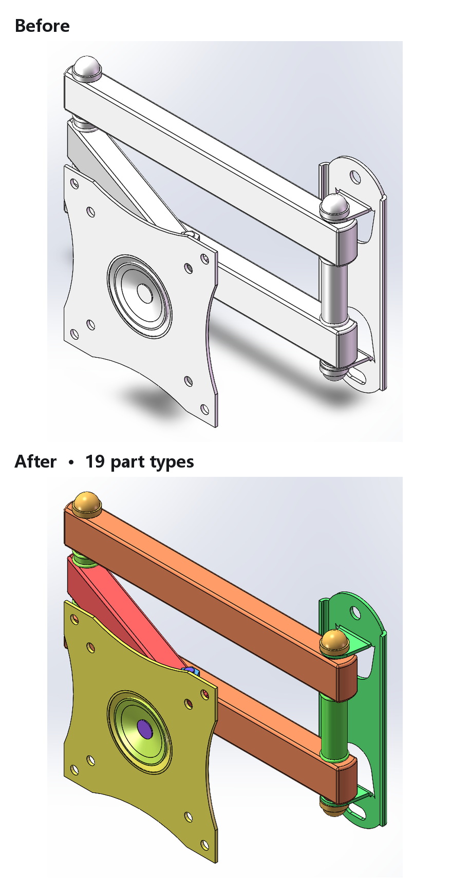
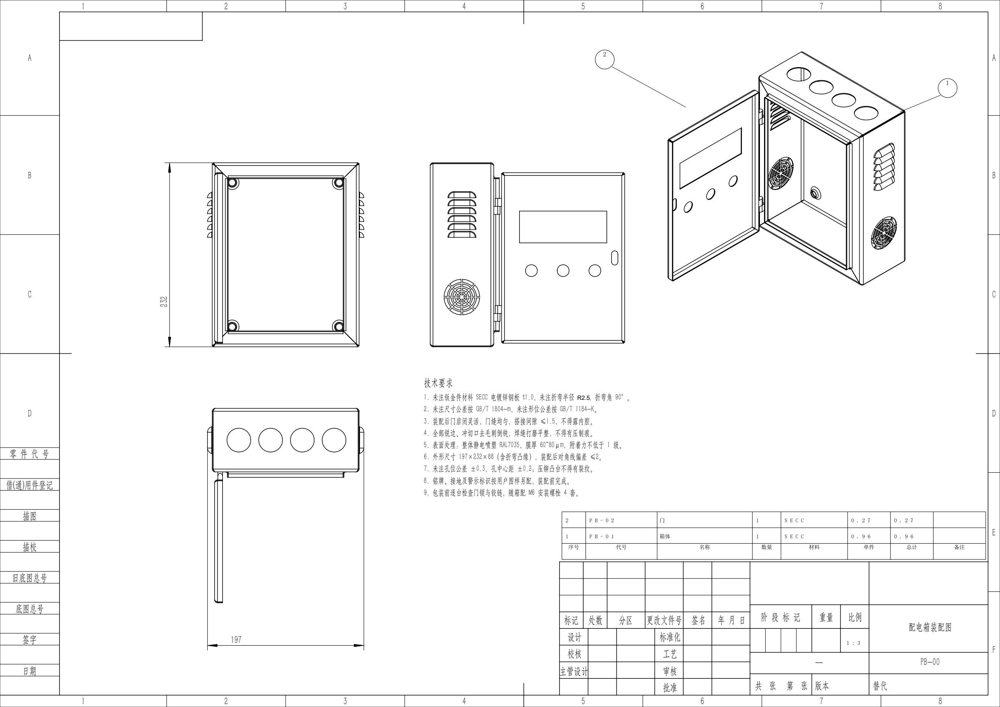
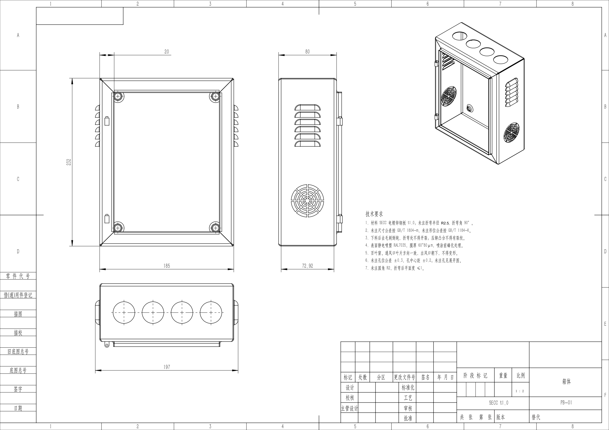
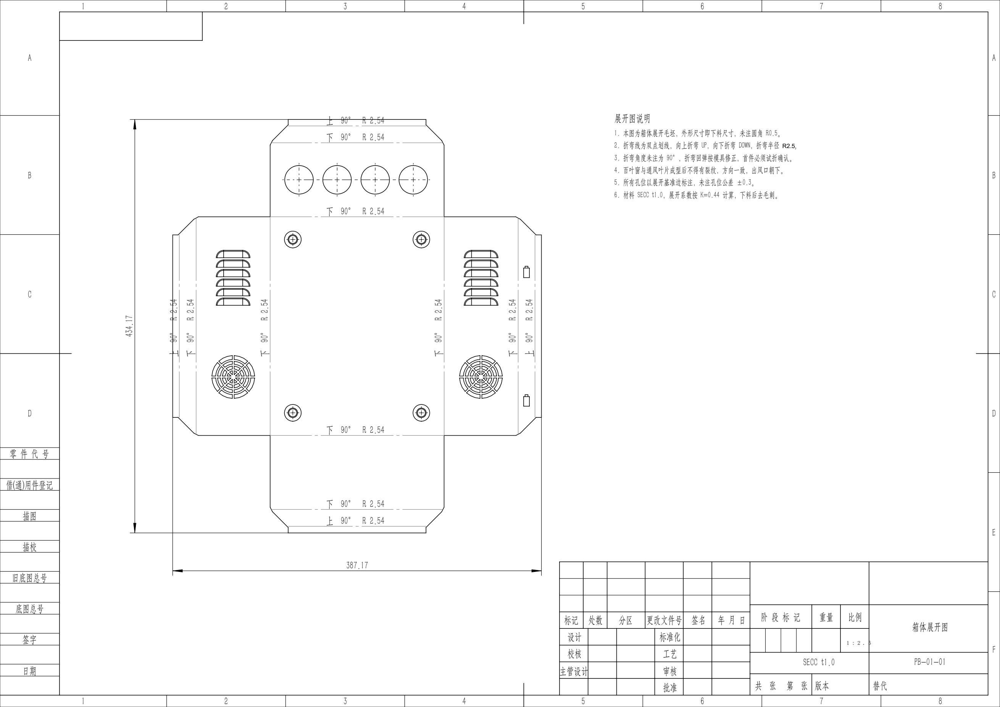
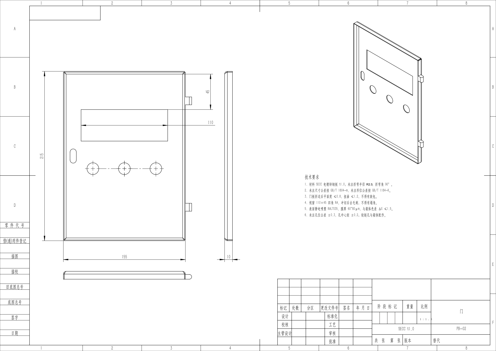
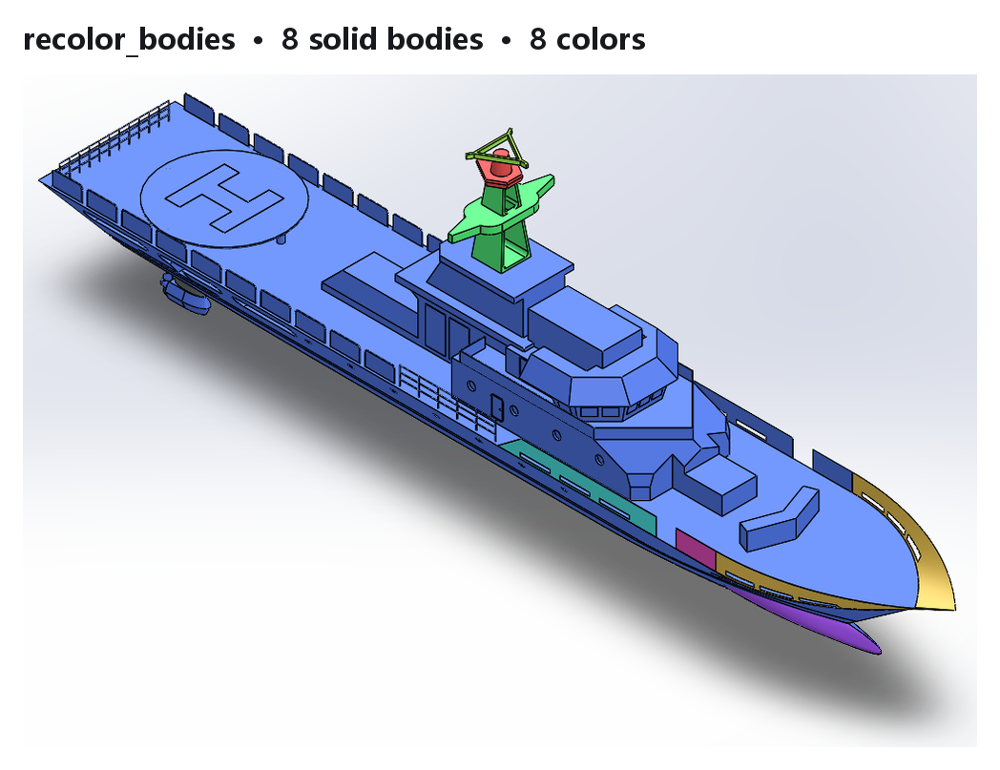

# Solidworks_AssetMate_MechDog



**一个会出图、也能证明这张图不能交的 SolidWorks MCP 服务。**

别的工具告诉你「生成了几张图」，它告诉你「台账 37 个尺寸里图上只找到 32 个、8 个尺寸挂不到几何上、0 个带公差，所以这张图只能算参考稿」。

**能做的不只是尺寸**：孔标注、形位公差、表面粗糙度、标题栏、**原生 BOM 明细栏**、技术要求注记，都是走 SolidWorks 原生对象——明细栏会随装配更新，件号与行号对应。

Windows + SolidWorks 2020+，纯 Python + COM，不需要编译 C# 插件。MCP 注册名：`Solidworks_AssetMate_MechDog`。

差异化不在"会调 API"，而在把 SolidWorks COM 的坑固化进代码与文档 → [docs/com-quirks.md](docs/com-quirks.md)。

最近一轮外部反馈的逐条对照（11 条问题、根因、证据强度、未做的理由）→
[docs/2026-11-05-feedback-closure.md](docs/2026-11-05-feedback-closure.md)。

---

## 实际产出

一套配电箱（钣金 t1.0）的完整生产图纸，全部由本工具生成：

| 图纸 | 内容 |
|---|---|
| 装配图 | 3 视图 + **原生 BOM 明细栏**（门/箱体）+ 件号气泡（**界面手插**，见下）+ 9 条技术要求 |
| 箱体零件图 | 4 视图 + 尺寸链 + 7 条技术要求（材料/折弯半径/喷塑） |
| 箱体展开图 | 展平 + 下料尺寸 + 折弯线 |
| 门零件图 / 展开图 | 同上 |

### 装配图（含 BOM 明细栏与件号）



> 右下角明细栏是**原生 BOM**（`BomFeature` 可取，会随装配更新），不是画线拼的表格。
> 件号 ① ② 与明细栏行号对应。
>
> **注意**：这两个气泡是**界面手工添加**的——`InsertBOMBalloon2` 需要 9 个必填参数、`InsertBalloon` 在 SW2024/SW2026 下都是 `DISP_E_UNKNOWNNAME`，所以没有对应的 MCP 工具，`check_capabilities` 里 `balloon` 标的是 `unsupported`。明细栏行号本身是正确的，手插时照抄即可。

### 箱体零件图



### 箱体展开图



### 门零件图



---

## 三个能力域

### 一、装配与零件（13）

| 工具 | 作用 |
|---|---|
| `get_assembly_tree` | 组件树：零件名、路径、颜色、子装配递归 |
| `export_bom` | BOM：按零件聚合，数量/材料/单重/总重，可写 CSV |
| `get_mass_properties` | 整机质量/体积/表面积/质心 |
| `recolor_assembly` | 按零件类型批量上色（黄金比例配色，同零件同色） |
| `recolor_bodies` | 多实体零件逐实体分色 |
| `list_bodies` | 零件实体清单（面/边/顶点数） |
| `rename_components` | 重命名零件文件，可选重定向装配引用 |
| `export_preview` | 视图导出 BMP/PNG |
| `batch_export` | 批量 STEP（默认 dry-run，不覆盖） |
| `set_part_material` | 指定材质，回读材质与质量变化 |
| `assign_materials` | 按名称关键词智能分配（标准件→碳钢，结构件→铝） |
| `material_library` | 列本地材质库名称（解析受限，见边界） |
| `build_feature_ledger` | **特征台账**：特征/驱动尺寸/孔候选/模型疑点/零件类别 |

### 二、工程图（42）

| 工具 | 作用 |
|---|---|
| `produce_drawing` | **一条命令出图**：台账→规划→建图→标注→自检→判定，按类别套默认值 |
| `create_drawing` | 建图：A0–A4、多视图、逐视图比例、`view_positions` 显式摆位、模板安全区实测 |
| `set_view` | 移动/缩放单个视图（`DISPATCH_PROPERTYPUT` + VARIANT，直接赋值会静默写错） |
| `place_views` | 批量摆视图：`[{view, x, y, scale}]` |
| `add_section_view` | 剖视图（自动画剖切线）；支持**模型坐标剖切面** `cut_plane_normal`/`cut_plane_origin`；`cut_line_ratio`（默认 0.55）按**短边**钳制剖切线长度。错误码：`section_empty` / `section_suspicious` / **`hatch_missing`（剖切面无剖面线，0.8.56 起不再 ok:true）** |
| `add_detail_view` | 局部放大（圆圈边界 + 独立比例）；请求比例不再被父视图覆盖，创建后数可见边，空视图返回 `detail_empty`、比例被锁返回 `detail_scale_locked` |
| `add_flat_pattern_view` | 钣金展开（下料尺寸 + 折弯线） |
| `survey_dimensions_by_view` | **只读诊断**：每个视图的尺寸数、最密的视图、空视图；用于判断「右视图为什么是空的」。**不能改派**——尺寸属于所在视图 |
| `auto_dimension` | 导入模型驱动尺寸，超 30 个会提示冗余；**按模型 full name 自动删除重复副本** |
| `delete_dimensions` | **按值保留/删除尺寸**，消费 `plan_drawing` 的短名单（实测 14 条一次调用 < 5 s） |
| `set_view_scale` | 改单个视图的比例（不必重建整张图） |
| `move_view` | 把单个视图移到图纸指定点（米） |
| `close_document` | 关闭 SolidWorks 仍占用的文档（释放文件，可删除/替换） |
| `add_center_marks` | 孔/槽中心标记与中心线（`view_name` 可限定视图） |
| `list_circular_edges` | 列视图内圆边（图纸坐标 + 直径），孔标注的前置工具 |
| `add_hole_callout` | 原生孔标注（带回读 + 模型孔径比对） |
| `add_hole_callouts` | **批量孔标注**：单视图可见边 → `AddHoleCallout2`，`IsHoleCallout` 判定（pilot），可指定引线落点 |
| `add_distance_dimension` | **两条边之间的距离**——总长这类「多段相加」的尺寸只能这样标；实测旋转轴 edge3–edge6 = 60.0 mm |
| `add_drawing_dimension` | 按边索引/坐标补标单个尺寸（失败返回最近边模型/图纸坐标 + 距离） |
| `add_dimension_tolerance` | 原生尺寸公差（双边/对称/极限/配合） |
| `add_datum_feature` | **基准要素符号**（三角形+字母），形位公差的基准真正指向它；`InsertDatumTag2` 挂在选中边上，用 `view_name`+`edge_index` 定位 |
| `add_geometric_tolerance` | **原生形位公差**（公差值 + 多基准 + 引线）；符号格写中文文字并回读校验，写不进就删框返回 `gtol_symbol_not_applied` |
| `add_surface_finish` | **原生表面粗糙度**（Ra 值，14 参数）；`InsertSurfaceFinishSymbol3` 会忽略 x/y，用 `SetPosition` 修正后回读，可选 PDF 像素 diff 自检 |
| `add_weld_symbol` | **角焊缝符号**（参考线 + 三角 + 焊脚尺寸 + 引线）；**`representation="sketch_block"`——草图线绘制，不是原生 IWeldSymbol**（该 API 在本环境不实例化几何） |
| `add_technical_requirements` | **技术要求整块写入**（一个 note 多行，不是 N 次 `add_note`）；自动编号 + 自动找空位（避开视图真实轮廓） |
| `add_note` | 技术要求注记（sheet 空间坐标，米） |
| `layout_dimensions` | **拆开叠在一起的尺寸**（按 x 聚类后沿 y 推开） |
| `delete_view` | **删除视图**（错切的剖视 / 空白局部放大） |
| `delete_annotation` | **删除标注**（按 name，回读计数确认） |
| `move_annotation` | **移动标注**到图纸坐标（米） |
| `set_dimension_position` | **移动单个尺寸**到图纸坐标（米），校验目标是尺寸并回读数值与位置 |
| `add_bom_table` | **原生 BOM 明细栏**（Indented→TopLevelOnly 两步，10 行 4 列含数量） |
| `add_sheet` | ✅ **可用**（0.8.196）：一个 `.SLDDRW` 内建多页。从 0.8.180 到 0.8.195 我一直写「`NewSheet4` 调不通」——**是我猜错了参数顺序**，`TemplateIn` 是第三个且必须是 int。实测 `('图纸1',)` → `['图纸1','图纸2']`。 |
| `list_sheets` | ✅ 列出每一页：名称、尺寸、视图、哪个是活动页。只有活动页会被其它工具修改。 |
| `activate_sheet` | ✅ 切页（按 `name` 或 `index`）。`add_sheet` 之后新页是活动的且**没有视图**，标注前先切回有视图的那一页。 |
| `add_view_to_sheet` | ✅ 在**指定页**建模型视图（先切页再 `CreateDrawViewFromModelView3`）。这是多页出图的另一半：`add_sheet` 建页，它往页上放东西。 |
| `measure_layout` | 量**现有**图纸：每个视图的包围盒、视图组占位、`views_fill_ratio`（远低于 1 说明视图散在包围盒里）、四周余量与 `min_margin_m`（还没被占用的版面预算）。只读，全部用 `precise_outline`。 |
| `add_sheet_line` | ✅ **能渲染，前提是 `AddToDB=True`**（2026-11-06 实测 572 像素；之前 0 像素是因为缺这个开关）。默认 `verify_render=True`，看 `visibility`：`changed_pixels>0` 画上了，`0` 返回 `line_not_rendered`，`checked:false` 表示渲染器不可用（**不等于没画**）。实测范围仅 SW2024 SP4 + 飞达动力轴 A3。 |
| `set_title_block` | 标题栏：文字匹配 + 位置兜底两级策略 |
| `list_drawing_edges` | 视图可见边（索引 + 模型坐标 + **图纸坐标** `sheet_start/end`；失败时 `sheet_projected:false` 带原因） |
| `export_drawing` | PDF / DWG / DXF |
| `render_drawing` | PDF → PNG，供目视检查 |

### 三、规划与自检（16）

| 工具 | 回答什么问题 |
|---|---|
| `drawing_audit` | 有没有空视图、越界、互相重叠 |
| `list_drawing_annotations` | 图上到底有多少尺寸/公差/形位公差/粗糙度（模板文字单列） |
| `verify_dimension_attachments` | 每个尺寸挂在边/面/草图段，还是根本没挂 |
| `prune_orphan_dimensions` | **清掉挂不到实体的尺寸**：按 name+position 删，`delete_dimensions` 按值做不到（三个 23 mm 无法区分）；dry-run 默认，删后重跑校验 |
| `reconcile_ledger` | **台账对账**：模型的 58 个尺寸，图纸上缺哪 7 个 |
| `plan_dimension_gaps` | **缺口补偿规划**：把真缺的尺寸配成边对，唯一匹配才补 |
| `delivery_check` | **这张图能不能交** |
| `sheet_metal_qc` | 板厚/弯折数/止裂槽；做不到的检查标 `not_checked`，不给假通过 |
| `flat_pattern_report` | 展开尺寸**谁算的**、工具没做什么、图上该写什么措辞 |
| `survey_drawings` | 抽样真实图纸出统计基线 + HTML 画像报告 |
| `plan_drawing` | 出图前规划：保留哪些尺寸、几张图、怎么拆（不建图） |
| `check_capabilities` | 动手前声明：哪些做不了、证据、替代方案；回显**运行中的版本 + 源码路径 + 解释器** |
| `ping` | **最轻的存活探针**（约 18 ms，不碰 ActiveDoc）：SW 版本、往返延迟、上一个工具、自愈计数 |
| `list_tool_profiles` | 71 个工具的**建议分组**（standard / drawing / expert / full）。**只是清单，不过滤任何工具**；`ungrouped` 非空说明有工具忘了归类 |
| `health_check` | **桥接与 SolidWorks 是否都活着**（可分辨"桥死了"与"SW 不响应"） |
| `recent_failures` | **读回当日失败日志**（工具名/参数/错误/SW 版本/健康快照） |

---

## 工程图闭环

```
特征台账 ──→ 出图 ──→ 标注 ──→ 自检 ──→ 交付判定
   │                             │           │
   │  有哪些特征/尺寸/孔          │  有没有  │  可制造
   └─────────────────────────────┴──────────→ 待设计审核
                                              仅供参考/未完成
```

`delivery_check` 的三种结论：

| 结论 | 触发条件 |
|---|---|
| **可制造** | 关键尺寸/孔/公差齐全，双重自检通过 |
| **待设计审核** | 图纸对象正确，但含调用方声明为「AI 拟定」的关键值 |
| **仅供参考/未完成** | 有越界/重叠/空视图、无尺寸、模型疑点、缺孔标注、尺寸无关联 |

实测配电箱箱体：

```
verdict: 仅供参考/未完成
blockers:  模型 Flat-Pattern1 被抑制
           图纸 0 处孔标注 / 模型 80 个圆柱面
pending:   27/53 尺寸读不到关联
           台账覆盖率 0.879（51/58，缺 7 个）
```

**这就是核心价值**：不是"生成成功"，而是"缺什么、能不能交"。

> 上面这条记录来自 v0.4 那次实测。现在孔标注已经能做（`add_hole_callouts`），
> 如果重跑，那行 blocker 会消失——但**工具依然会如实报出当时真实存在的缺陷**，
> 而不是因为"新版本支持了"就把历史问题抹掉。

---

## 真实图纸基线

判定标准不是凭感觉定的。用 142 套 SolidWorks 工程图模板里 **6346 张真实 SLDDRW** 抽样 100 张实测：

| 指标 | 平均 | 中位 | 范围 |
|---|---|---|---|
| 视图 | 3.1 | 3 | 1–9 |
| **尺寸** | **14.2** | **11** | 0–58 |
| 注释 | 46.5 | 36 | 0–160 |
| 中心标记 | 4.9 | 3 | 0–59 |

**制造类标注的出现率**

| 标注 | 占比 |
|---|---|
| 表面粗糙度 | **60%** |
| 形位公差 | **7%** |
| 零件序号 | 3% |

据此改掉三条拍脑袋的标准：

| 原来 | 改后 | 依据 |
|---|---|---|
| 全量导入 44 个尺寸 | 提示冗余 | 真实 14 个，制图是筛选不是搬运 |
| 要求形位公差 | 降为可选、粗糙度升为常规 | 7% vs 60% |
| 视图无尺寸即报警 | 只在整张图无尺寸时报警 | 原判定 79/100 误报，改后 6 |

复跑基线（换新图纸后应重做）：

```json
{ "folder": "D:/142套solidworks工程图图纸模板",
  "sample_size": 100, "seed": 28,
  "html_path": "D:/out/survey_report.html" }
```

固定 `seed` 保证样本可复现，改阈值前后能直接对比。

---

## 破坏性变更记录

| 版本 | 变更 | 影响 |
|---|---|---|
| 0.4.7 | `set_part_material` 的 `material` 参数改名 `material_name` | 旧调用会 schema 校验失败，需同步改参数名（改名是为了修参数遮蔽模块名的 bug） |

## 能力边界（诚实披露）

权威来源是 `check_capabilities` 的输出——下表是它的摘要，若与工具输出冲突，以工具为准。

| 限制 | 原因 | 影响 |
|---|---|---|
| **孔标注只覆盖朝向观察者的孔边** | 同一孔的两个面只有正面能标，背面返回 null（实测 door.SLDPRT：Ø8/Ø15 成功，Ø6 背面 8 条全失败） | 记 `hidden_side`，用 Ø 尺寸补；或换视图 |
| **`material_library` 按文件名查找不可靠** | 传绝对路径可用（UTF-16 已修）；按文件名在 PROGRAMDATA/APPDATA 下遍历可能漏 | 建议传完整路径 |
| **A3 最多 3 个视图** | 视图多了会互相挤占；剖视的强制对齐已可用 `set_view(break_alignment=True)` 解除（内部先 `IView.RemoveAlignment` 再写坐标） | 必要时拆两张图（结构 + 展开） |
| **装配体拿不到包围盒** | `IAssemblyDoc` 没有 `GetPartBox`，组件 `GetBox` 在轻化下返回 None | 比例靠实测安全区推算 + 建完测量降档兜底 |
| **尺寸跨视图去重需外部传值** | 图纸尺寸是投影长度，同一条边不同视图值不同 | 去重只能靠调用方给 `known_values` |
| **`produce_drawing` 会多标尺寸** | 默认 `prune_to_plan=true` 已按规划删除多余尺寸；`dimension_filter` 全不匹配时一条不删 | 看 `dimension_gap.pruned_to_plan` 与 `filter_aborted` |
| **图面利用率低** | 布局只保证不越界，不保证填满 | 视图偏小、留白多，需人工放大 |
| **件号圆圈（BOM balloon）** | `InsertBOMBalloon2` 需 9 个必填参数；`InsertBalloon` 在 SW2024/SW2026 均 `DISP_E_UNKNOWNNAME` | 用 `add_note` 写数字，引线可用 `add_sheet_line`（**需 `AddToDB`，见工具表**），或界面手插 |
| **展开计算与校验（flat_pattern_calc）** | 工具不读 K 因子，展开由 SolidWorks 自己算 | 用 `flat_pattern_report` 声明依据，不要拿它做展开验证 |
| **把驱动尺寸补插到第二个视图** | `InsertModelAnnotations3` 是文档级幂等，参数改不出来 | 用 `list_drawing_edges` + `add_drawing_dimension(view_name=...)` 在该视图重新标注 |
| **建模 / 特征创建（geometry_creation）** | 本工具只处理已有模型的出图，不做 CAD 建模 | 用 SolidWorks 或 solidpilot 类工具建模 |
| **批量读图需逐张关闭** | SolidWorks 开 40+ 文档后任何新文件都打不开 | 批量脚本必须 `CloseDoc` |
| **`model_clean` 不再阻断交付** | 本工具出图与自检，**明确不重建模型**；源模型 `needs_rebuild` 属模型侧状态，调用方在工具链内无法消除 | 0.8.23 起降为 pending 提示项，不再让 verdict 永远到不了「可制造」 |
| **没有线程级硬超时** | pywin32 在拥有对象的 STA 线程上派发；把调用丢到工作线程再「超时放弃」会破坏 COM 公寓，而不是取消调用 | 改为「存活探针（18 ms，2 秒节流）+ 忙时退避重试 2 次 + 断线自动重连」，`ping` 可分辨"活着但忙"与"死了"；单次真正挂死仍会阻塞 |
| **DXF/DWG 逆向建模** | 未实现 | 只有 SolidWorks 原生图纸能读 |

设计原则第一条就是：**工具返回成功 ≠ 图纸正确**。所以每步都回读。

开发约定见 [CONTRIBUTING.md](CONTRIBUTING.md)——核心一条：**改完必须跑一次真实调用**。

```bash
python tests/check_all.py       # 秒级：语法 + 结构 + 291 条历史回归
python tests/stdio_contract.py  # 不需 SolidWorks：真实 stdio 进程的工具契约
python tests/smoke.py           # 需 SolidWorks：行为层（仓库不含测试模型，见下）
```

`stdio_contract.py` 起一个真进程走 MCP 握手，验证 `tools/list` 中每个 tool 顶层
`inputSchema.additionalProperties` 都是 `false`、pydantic 生成的嵌套声明未被误改、
正常调用仍能通过校验、未知参数被 `_install_argument_guard` 拒绝。**schema 声明与
运行时守卫是两件事**：mcp 1.30.0 下只有声明、没有守卫时，`ping({"bogus_param":123})`
照样 `ok:true`（pydantic `extra="ignore"` 丢键）；而客户端也可能在发送前按 schema
本地过滤，让服务端守卫看不到原始参数。两者不能互相替代，详见
[docs/com-quirks.md](docs/com-quirks.md) 的 2026-11-10（v0.8.292）一节。

---

## 快速上手

**出一张图并自检**

```json
// 1. 建图
{ "model_path": "D:/parts/P05.SLDPRT", "output_path": "D:/out/P05.SLDDRW",
  "views": ["front", "right"], "paper": "A3", "view_scales": { "right": 0.2 } }

// 2. 标注（导入 + 中心标记 + 标题栏）
{ "drawing_path": "D:/out/P05.SLDDRW", "all_views": true, "include_unmarked": false }
{ "drawing_path": "D:/out/P05.SLDDRW", "name": "履带轮", "code": "P05", "apply": true }

// 3. 判定能不能交
{ "model_path": "D:/parts/P05.SLDPRT", "drawing_path": "D:/out/P05.SLDDRW" }
```

**查缺哪些尺寸**

```json
{ "model_path": "D:/parts/P05.SLDPRT", "drawing_path": "D:/out/P05.SLDDRW" }
→ coverage 0.879, unmatched_by_feature: { "Cut-Extrude1": [1.0, 30.0], "Vent1": [1.0] }
```

**装配上色**

```json
{ "assembly_path": "D:/models/beast.SLDASM",
  "palette": { "Crank": [0.88, 0.20, 0.18], "Frame": [0.36, 0.40, 0.45] },
  "apply": false }
```

dry-run 确认零件与匹配数无误后，再 `apply=true`。



---

## 视图数量与拆图策略

A3 / 1:2、带标注的情况下实测：

| 图幅 | 视图数 | 结果 |
|---|---|---|
| A3 | 2–3 | `drawing_audit` 零警告 |
| A3 | 4 | 互挤，常压到左侧明细栏 |
| A3 | 5 | 越界 + 重叠，不可用 |

**剖视图位置半锁**：与父视图 x 对齐（`Position` 只有 y 生效），只能放在源视图正上/正下方。

**拆图建议**（钣金件必用）：

1. **结构图**：主视 + 侧视 + 剖视（≤3 视图）
2. **展开图**：钣金展开 + 成型对照视图

实测配电箱：5 视图一张 = 4 处越界 + 1 重叠；拆成两张 = 两张都零警告。

---

## auto_fit 实测

自动比例在三个数量级的真实装配上验证过（原路径建图，图纸输出到临时目录）：

| 装配 | 包围盒 | 自动比例 | 结果 |
|---|---|---|---|
| LX-12 输送 | 108 × 42 × 42 mm | 1:1 | 双视图并排，无越界 |
| 焊接夹具 3C01400300A0 | 687 × 86 × 182 mm | 1:5 | 含 Ø8.5 标注，无越界 |
| 条码设备 SAB1_0000_000 | 1601 × 1576 × 770 mm | 1:20 | 整机轮廓完整，无越界 |

三张图的比例都是一次算对的，`auto_scale_adjustments` 为空——降档兜底没有被触发。

**注意**：装配体不能脱离引用复制后再建图。只复制 `.SLDASM` 会让组件引用全断，
`CreateDrawViewFromModelView3` 返回的视图没有任何几何（三个视图 outline 都是 35.7×25.2 mm），
看起来像"装配建图坏了"。要么在原目录建图，要么整目录复制。

## 出图前先问两句

```json
// 1. 什么做不了？
{ "operation": "hole_callout" }
→ status: pilot, why: 视图可见边 + AddHoleCallout2，SW2026 无弹窗；背面孔返回 null

// 2. 该标哪些尺寸？
{ "model_path": "D:/parts/P05.SLDPRT", "paper": "A3" }
→ driving 70 → keep 11（15.7%），附每条的选取理由与拆图建议
```

真实图纸尺寸中位 11 个；全量导入会把 70 个驱动尺寸全倒上去——制图是筛选，不是搬运。

## 环境与安装

- Windows + SolidWorks 2020+（开发验证 2024 SP4；用户实测 2026 SP0 可用）
- 64 位 Python 3.10+，与 SolidWorks 位数一致

```bash
pip install .
# Pillow 与 pypdfium2 已随包安装（0.8.23 起）——渲染是自检链路的一环，不是可选装饰。
# 旧命令 pip install ".[png]" 仍然可用，作为兼容别名。
```

| 现象 | 处理 |
|---|---|
| 隔离构建下载 `setuptools` 失败 | Python ≥3.12 的全新 venv 先 `pip install setuptools wheel`，再 `pip install -e ".[png]" --no-build-isolation` |
| 镜像报 `from versions: none`（实为 403） | 换源 `-i https://mirrors.aliyun.com/pypi/simple/` |
| 找不到 `solidworks-assetmate-mechdog` 命令 | 入口在 `<python>\Scripts`，改用 `python -m` |
| 工程图视图创建返回空 | 0.3.0 已处理（中文版视图名 `*前视`） |
| 所有工具报 `int() argument must be ... VARIANT` | 0.1.5 已修复（强制晚绑定） |

MCP 注册（不依赖 PATH）：

```json
{
  "mcpServers": {
    "Solidworks_AssetMate_MechDog": {
      "command": "python",
      "args": ["-m", "solidworks_assetmate_mechdog.server"]
    }
  }
}
```

---

## 发布与自检

### 版本号只用脚本改

```bash
python tools/bump_version.py --check   # 报告状态，不改文件
python tools/bump_version.py           # 0.8.285 -> 0.8.286
python tools/bump_version.py --to 0.9.0
```

`--check` 是 **fail-closed**：版本两处不一致、HEAD 与上一 tag 相同、**或当前目录不是 git
工作树**（tarball / wheel 安装无 `.git`）都返回 `1`。最后一种会明确打印
`UNVERIFIABLE — the duplicate-tag check was NOT run`——旧版在这时会打印
`HEAD ? is ahead of (no tag) — safe to tag`，一个根本没跑过的检查不能报安全（0.8.293 修）。

`bump_version.py` 做四步：**读当前版本 → 算下一个 → 写入 → 重新读回来断言确实变了**。
写不进去就 `exit 2`。

**为什么不用 `sed`**：历史上三次发版（0.8.134-136 / 0.8.264-265 / 0.8.272）都是
`sed 's/0.8.271/0.8.272/'` 匹配不到却退出 0，commit 和 tag 照发。`v0.8.272` 与
`v0.8.271` 指向同一个 commit，`pyproject.toml` 却还写 `0.8.271`。

### tag 由三处来源比对

`static_check.py` 每次读 tag 都按 **CI 环境变量（`GITHUB_REF_NAME` / `CI_COMMIT_TAG` /
`GIT_TAG`）→ 随包 `_build_meta.json` → `git describe`** 的顺序回退，然后与
`pyproject.toml` 的 version 做**相等**比较：

```text
tag_compare: v0.8.285 == pyproject 0.8.285  [source: packaged (SELF-DECLARED, not an external tag)]
```

- `packaged` 那份由 `bump_version.py` 和版本号同一次写入，**是自证不是外部证据** ——
  所以标注写 `SELF-DECLARED`，不写成「已核对」。
- `_build_meta.json` 通过 `pyproject.toml` 的 `[tool.setuptools.package-data]` 随包分发，
  tarball / wheel 安装也有 tag 源。

### 门禁是 fail-closed

**读不到 tag 源就失败，不是跳过。**

```text
tag_compare: no tag source (no CI env var, no _build_meta.json) and HEAD cannot be shown
             to be between tags — version not verifiable        → RC 1
```

唯一允许的跳过：工作树里 HEAD 处在两个 tag 之间（正常的发布中途状态）。
`git describe` 报 `not a git repository` 视为**无法判断**，不是「不在 tag 上」——
这两种曾被混成一种，于是任何非仓库目录都能让门禁放行。

### 两套件分开报

```text
all offline checks passed
  source-level : <N> assertions (text/AST only)
  on-machine   : <M> checks, NOT run here — `python tests/smoke.py`
```

**`source-level` 只读源码文本**，不驱动 SolidWorks。把它当成行为证据是本项目犯过的错
（v0.8.273 的断言通过了，图上主孔却没标）。真机覆盖只算 `smoke.py` 里那些 `r.check`。

### 部分结果不等于成功

`ok()` 用 `setdefault`，调用方可以传 `ok=False`；`add_hole_callouts` 在跳过倒角歧义直径时
就传 `ok=False, verdict="partial"`，并写 `partial_reason` 与 `excluded_diameters_mm`。
`produce_drawing` 会把它抬到顶层（`ok:false` + `partial_steps`）、写进 `pending`，
并由 `_callout_warning()` 说明缺哪几个直径。

单孔 `add_hole_callout` 另给 `text_flags`：读不到图面文字时报 `text_unreadable`，
带深度符号时报 `depth_on_a_through_bore_suspect` —— **`ok:true` 不等于文字是对的**。

## 真机回归

```bash
python tests/smoke.py
# 测试用例/ 是本地目录，.gitignore 整树排除——clone 下来没有模型。
# 三个夹具（零件 / 装配体 / 钣金件）指到本机任意模型即可：
```

**第一项是静态检查**（`tests/static_check.py`，0.0 s，不需要 SolidWorks）：扫描 `server.py`
里 71 个工具函数，确认每个 `name.attribute` 的 `name` 都有 import 或定义、每个 wrapper
转发的参数都在签名里。0.4.6 那种"调用即崩"的 `NameError` 会在这里被挡住，而不是等 COM 跑完。

```bash
python tests/static_check.py     # 单独跑，秒级
```

默认跑全部必需项（另可用 `--eng-cases` 加跑真实零件链路）：连接/版本、组件树与错误信息、BOM+CSV、质量属性、上色 dry-run/零匹配/apply、实体列表/分色、预览 PNG、STEP 导出、工程图链路（建图→PDF→渲染→审计）、孔标注清单（P0）、**孔标注引线落点（P1-7）**、尺寸去重、**auto_dimension 按 full name 自动去重**、原生 BOM 表、按名编辑（移动/删除标注、**四类标注删除（note/GT/粗糙度/尺寸）**、删尺寸、移视图、尺寸排版、删视图、**单尺寸移动 + 类型守卫**）、`health`、标注写入（形位公差**符号文字 fallback（P2-10）**/粗糙度/尺寸公差）、**表面粗糙度位置与像素可见性（P2-11）**、规划入口、视图/明细/标题栏（含**局部视图判空与比例守卫（P2-9）**、**剖切面映射与 sanity 校验（P1-4）**）、零件工具、单孔标注、重命名 dry-run、展开视图、材料写入诚实性、台账对账+交付判定（含 **Ø 计数按 `dimension_type` 而非显示文本（P1-1）**、**0.0 约束值不计入覆盖率（P3-5）**、**orphan 尺寸清理（P2-4）**）、**圆边枚举按 CircleParams（P1-2）**、**注记避让（P3-2）**、**plan 绑定标注（N3）**、**去重失败计数（P0）**、**尺寸外推分层（P0-1）**、**server 包装层签名契约**、**桥接自愈（P0-1，放最后：会故意污染 COM 缓存）**。全部只读或写临时目录。

**仓库不含测试模型**（`测试用例/` 因体积与版权未入库），裸跑会因文件不存在直接退出。用 `--assembly` / `--part` 指定自己的模型：

```bash
python tests/smoke.py --assembly D:/models/your.SLDASM --part D:/parts/your.SLDPRT
python tests/smoke.py --skip-export --skip-drawing    # 只跑快项
```

**第二个入口：真实零件链路**

```bash
# 默认用 测试用例/工程图测试用例（4 个行业分类，1460 个零件）
python tests/smoke.py --skip-export --skip-drawing --eng-cases --eng-sample 1
```

`--eng-cases [folder]` 依次跑「台账 → 建图 → 标注 → 审计 → 对账 → 交付判定」，
按行业目录各取一个零件（确定性挑选，跨次可比）。断言项：台账有包围盒、建图有视图、
审计无越界/重叠、对账有覆盖率、判定有结论。

实测（KSHE-016.001）：23/63 个尺寸、覆盖率 0.769、判定「仅供参考/未完成」，85 秒。

首次约 5–8 分钟（解析轻化组件），之后 1–2 分钟。**跑前建议清理 SolidWorks 中堆积的文档**，否则会因同名文件打不开而全线失败。

---

## 性能

慢在 SolidWorks COM 往返和文件加载，不在 Python 侧。

| 操作 | 耗时 |
|---|---|
| `get_assembly_tree` 首次（46 组件） | 163 s |
| `recolor_assembly` apply（46 件） | 121 s |
| 工程图建图 + 3 视图 + 导出 | 12 s |
| `drawing_audit`（真实图纸） | 2–4 s |
| `survey_drawings`（100 张真实图） | 1916 s（19 s/张） |

首次操作单个装配请预留 2–3 分钟，不要用默认 30–60 秒超时。

---

## 设计原则

1. **工具返回成功 ≠ 图纸正确** — 每步回读（孔标注读孔径、尺寸读公差类型、剖视读实际切到的位置）
2. **接口报错 ≠ API 不存在** — 见下方专节，这条差点让形位公差被判死刑
3. **统一会话层** — 所有工具共用 `sw_session`，慢调用只取一次
4. **写操作先快照** — 默认 dry-run，返回修改前的值
5. **不编造结果** — COM 不可用时返回结构化错误 + 坑文档编号，绝不假装成功
6. **判定要有依据** — 阈值由 100 张真实图纸实测，不是凭感觉
7. **每个工具配坑笔记** — 新增工具必须同步 `docs/com-quirks.md`

## 接口报错 ≠ API 不存在

`DISP_E_MEMBERNOTFOUND` 有三种完全不同的来源，混为一谈会把自己堵死：

| 来源 | 症状 | 怎么排除 |
|---|---|---|
| ① **属性/方法派发方式错** | `doc.InsertGtol()` 报 MEMBERNOTFOUND | `_FlagAsMethod(name)` 或 `ole.Invoke(dispid, 0, DISPATCH_METHOD, True)` |
| ② **接口指针不对** | 方法在另一个接口上 | `QueryInterface` 到目标接口再试 |
| ③ **运行时真的没实现** | 以上都试过仍失败 | 才能下这个结论 |

**形位公差就是这个坑**：`win32com` 把 `InsertGtol` 当成属性读取（`DISPATCH_PROPERTYGET`），
必然返回 `MEMBERNOTFOUND`。改成 `DISPATCH_METHOD` 立刻拿到对象——**同一个 DISPID，一个标志位之差**。

我此前只测了 ① 的一种写法，就断言 ③，还在 release notes 里写「C# 插件也绕不过」，绕了两天。

**规则**：写「这个 API 不存在」之前，三种来源必须逐一排除并留下证据。
诊断脚本见 `tests/` 与 `docs/com-quirks.md`。

---

## 路线图

完整规划见 [docs/ROADMAP.md](docs/ROADMAP.md)。

- ~~v0.3 出图链路~~ ✅
- ~~v0.4 台账 / 公差 / 自检 / 交付判定~~ ✅
- ~~v0.5 孔标注定位 / 能力声明 / 出图前规划~~ ✅
- ~~v0.6 形位公差 / `produce_drawing` 流水线~~ ✅（0.6.1）
- ~~v0.7 排版能力 / 钣金 QC / 展开依据~~ ✅
- ~~v0.8 BOM 明细栏 / 第四道静态防线 / 边枚举提速~~ ✅（0.8.2）
- **v0.9 待做**：几何测距（折弯边/孔到折弯线）、尺寸精准筛选、图面利用率、`GetPolylines7`

---

## License

MIT © 2026 wudahua
